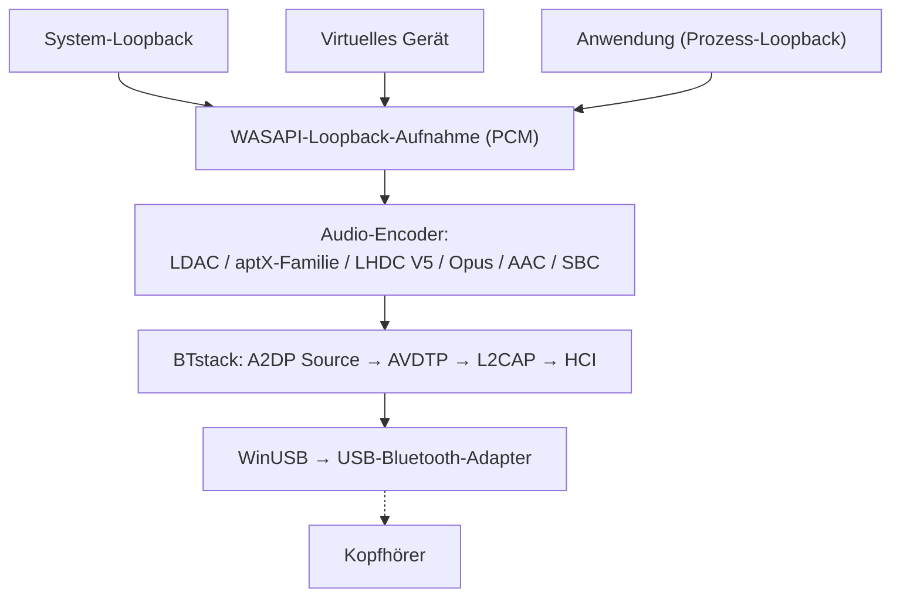

# BlueCaster

Leistungsstarker Bluetooth-Audiosender für Windows mit voller Codec-Unterstützung.
{: .fs-6 .fw-300 }

BlueCaster macht aus Ihrem Bluetooth-Adapter einen Hi-Fi-Audiosender. Damit streamen Sie Hi-Fi-Codecs wie **LDAC@96 kHz**, **LHDC V5@192 kHz** und **aptX Adaptive** an Ihre Kopfhörer und Ohrhörer. Windows selbst unterstützt keinen dieser Codecs. Außerdem unterstützt BlueCaster aptX HD, aptX, aptX Low Latency, Opus, AAC, SBC XQ, SBC und FastStream.

- **Funktioniert mit dem Bluetooth, das Sie schon haben.** Das eingebaute Bluetooth von Intel, Realtek oder MediaTek in vielen Notebooks funktioniert, ebenso ein günstiger USB-Dongle. BlueCaster übernimmt den Adapter, und mit einem Klick geben Sie ihn an Windows zurück.
- **Ein Headset-Mikrofon, das nicht stört.** Das Mikrofon schaltet sich nur ein, während eine App aufnimmt. Den Rest der Zeit hören Sie Musik in voller Qualität. Rauschunterdrückung und Verstärkung sind eingebaut.
- **Keine zusätzlichen Tools nötig.** BlueCaster richtet den Adapter direkt in der App ein ([so funktioniert es](architecture)).

[Erste Schritte](setup){: .btn .btn-primary .fs-5 .mb-4 .mb-md-0 .mr-2 }
[GitHub](https://github.com/SeiyaFunaokaJP/BlueCaster){: .btn .fs-5 .mb-4 .mb-md-0 }

---

## Unterstützte Codecs

| Codec | Bitrate | Abtastrate | Bittiefe | Latenz |
|:------|:--------|:-----------|:---------|:-------|
| LHDC V5 | 400/500/900/1000 kbps, ABR 160--400 kbps | 44,1/48/96/192 kHz | 16/24 Bit | -- |
| LDAC | 330/660/990 kbps | 44,1--96 kHz | 16/24/32 Bit | ~200 ms |
| aptX Adaptive | 265/427 kbps (96 kHz: 646) | 48/96 kHz | 24 Bit | -- |
| Opus | 256 kbps | 48 kHz | 16 Bit | -- |
| aptX HD | 576 kbps | 44,1/48 kHz | 24 Bit | ~150 ms |
| aptX | 352/384 kbps | 44,1/48 kHz | 16 Bit | -- |
| aptX Low Latency | 352 kbps | 44,1/48 kHz | 16 Bit | ~32 ms |
| AAC | bis 256 kbps | 44,1/48 kHz | 16 Bit | ~150 ms |
| SBC XQ | ca. 385/505/552 kbps | 44,1/48 kHz | 16 Bit | ~150 ms |
| SBC | bis ca. 345 kbps | 44,1/48 kHz | 16 Bit | ~150 ms |
| FastStream | 198/216 kbps | 44,1/48 kHz | 16 Bit | -- |
| Opus 05 | 256 kbps | 48 kHz | 16 Bit | -- |
| LC3 (LE Audio) 🧪 | 32--124 kbps pro Kanal | 16/24/32/48 kHz | 16 Bit | ~140 ms |
| LC3 LL (LE Audio GMAP) 🧪 | 64--96 kbps pro Kanal | 32/48 kHz | 16 Bit | ~30 ms |

### Codec-Unterstützung nach Plattform (Senden an Kopfhörer)

| Codec | Windows 10 integriert | Windows 11 integriert | Ubuntu integriert (PipeWire) | **BlueCaster** (Windows 10 / 11) |
|:------|:---------------------:|:---------------------:|:----------------------------:|:----------------------------:|
| LHDC V5 | ❌ | ❌ | ❌ | ✅ |
| LDAC | ❌ | ❌ | ✅ | ✅ |
| aptX Adaptive | ❌ | ❌ | ❌ | ✅ |
| Opus (A2DP-Opus von Android) | ❌ | ❌ | ✅ PipeWire 1.2+ (`opus_g`); nicht in Ubuntu 24.04 (PipeWire 1.0.5) | ✅ |
| aptX HD | ❌ | ❌ | ✅ | ✅ |
| aptX | ✅ | ✅ | ✅ | ✅ |
| aptX Low Latency | ❌ | ❌ | ✅ | ✅ |
| AAC | ❌ | ✅ | ❌ nicht in den Ubuntu-Paketen | ✅ |
| SBC XQ | ❌ | ❌ | ✅ | ✅ (Empfänger, deren SBC Dual Channel und Bitpool ≥ 29 erlaubt) |
| SBC | ✅ | ✅ | ✅ | ✅ |
| FastStream | ❌ | ❌ | ✅ | ✅ (nur Musik, nur bei ausdrücklicher Auswahl) |
| Opus 05 (eigenes Opus von PipeWire) | ❌ | ❌ | ✅ PipeWire 0.3.57+ (`opus_05`, nur zu PipeWire-Geräten) | ✅ (nur bei ausdrücklicher Auswahl, nur im Entwicklermodus) |
| LC3 (LE Audio, BAP Unicast) | ❌ | ✅ auf PCs, deren Bluetooth-Hardware und -Treiber LE Audio unterstützen | ✅ PipeWire BAP `lc3` (LE Audio von BlueZ) | 🧪 experimentell, nur im Entwicklermodus (LE-Audio-Eintrag eines Geräts; GMAP mit niedriger Latenz bei Gaming-Headsets; Adapter mit Bluetooth 5.2 und ISO, [Verwendung](usage#le-audio)) |

✅ unterstützt · 🧪 experimentell · ❌ nicht unterstützt. Alle Spalten beziehen sich auf die Sendeseite (PC → Kopfhörer). „Integriert“ bedeutet das Bluetooth-Audio des Betriebssystems ohne BlueCaster. Die Ubuntu-Spalte zeigt die PipeWire-Codecs von Ubuntu 26.04 (`libspa-0.2-bluetooth`).

{: .warning }
**aptX HD und aptX Low Latency** folgen den Implementierungen von Android und PipeWire und bestehen Round-Trip-Tests (Kodieren und Dekodieren), sind aber noch nicht mit echten Kopfhörern geprüft. Die Latenzwerte in dieser Tabelle sind typische Werte und wurden nicht mit BlueCaster gemessen.

{: .warning }
**Zu LHDC V5.** BlueCaster verwendet eine C-Portierung des LHDC-V5-Encoders, den Google in Android 17 aufgenommen hat (AOSP, Apache-2.0). Die Ausgabe der Portierung ist bitgenau identisch mit dem Rust-Encoder aus AOSP, und die A2DP-Signalisierung folgt `a2dp_vendor_lhdcv5` von Android. Ein Nutzer hat LHDC V5 unter v1.1.1-beta.1 mit echten LHDC-V5-Kopfhörern bei 1000 kbps / 192 kHz bestätigt ([#50](https://github.com/SeiyaFunaokaJP/BlueCaster/issues/50)). v2 verwendet denselben Encoder. Unterstützt wird nur das verlustbehaftete LHDC V5: Für LHDC V2/V3 (ältere Kopfhörer) und den verlustfreien Modus „LHDC-RAW“ gibt es keinen Open-Source-Encoder. Bei automatischer Auswahl steht LHDC V5 an erster Stelle, noch vor LDAC.

{: .warning }
**Opus** ist der A2DP-Opus-Herstellercodec von Android (Android 13+, Vendor ID 0x000000E0 Google): 48 kHz, 20-ms-Frames und 256 kbps Stereo, wie von Android angefordert (Standard 192, Mobil 128 kbps), kodiert mit libopus 1.6.1. Opus besteht den End-to-End-Test mit einer virtuellen Senke, ist aber noch nicht mit echten Opus-Kopfhörern geprüft. Bei automatischer Auswahl steht Opus hinter aptX Adaptive und vor aptX HD.

{: .warning }
**Opus 05** ist der eigene A2DP-Opus-Herstellercodec von PipeWire (Vendor ID 0x000005F1, Codec 0x1005; PipeWire `opus_05`). Nur PipeWire implementiert ihn, der Empfänger muss also ein PC sein, auf dem PipeWire als A2DP-Senke läuft. BlueCaster sendet nur Stereo-Musik (kein 5.1 / 7.1, kein Rückkanal): 48 kHz, 10-ms-Frames (20 ms, wenn die Senke nur diese unterstützt), mit demselben libopus-Encoder und denselben Bitraten wie Opus, begrenzt auf das Limit der Senke. Die automatische Auswahl wählt Opus 05 nie. Wählen Sie es unter **Codecs** oder mit `-c opus05`. Opus 05 besteht den End-to-End-Test mit einer virtuellen Senke, die die Fähigkeiten von PipeWire meldet, ist aber noch nicht mit einem echten PipeWire-Empfänger ausprobiert. Als A2DP-Senke dekodiert PipeWire Opus 05 seit 0.3.57 und das Opus von Android (`opus_g`) seit 1.2.0. Ubuntu 24.04 LTS liefert PipeWire 1.0.5 (nur Opus 05), Ubuntu 25.10 (1.4.7) und 26.04 LTS (1.6.2) liefern beide. Keiner der beiden Codecs ist bisher mit BlueCaster getestet.

{: .warning }
**SBC XQ** wurde mit einem Sony WH-1000XM4 geprüft (Dual Channel, Bitpool 43 bei 48 kHz, 552 kbps). Lehnt ein Empfänger diese Konfiguration ab, verbindet BlueCaster sich mit normalem SBC neu. **FastStream** besteht den End-to-End-Test mit einer virtuellen Senke, ist aber noch nicht mit echten FastStream-Kopfhörern ausprobiert. FastStream überträgt nur Musik, und die automatische Auswahl wählt es nie.

{: .note }
**Brauchen Sie nur klassisches aptX?** Windows 10 unterstützt klassisches aptX bereits im integrierten Bluetooth-Stack (nicht aptX HD, aptX LL oder aptX Adaptive). Dafür brauchen Sie BlueCaster also nicht. BlueCaster lohnt sich vor allem für LHDC V5, LDAC, aptX Adaptive, aptX HD und aptX Low Latency.

{: .note }
**Zu aptX Adaptive.** BlueCaster kodiert mit dem MIT-lizenzierten, rein in Rust geschriebenen Encoder von [AKS-Logic/aptx-adaptive-linux](https://github.com/AKS-Logic/aptx-adaptive-linux). Dessen Autoren haben die Tabellen des Encoders aus ausgelieferten Qualcomm-Binärdateien und Funkmitschnitten rekonstruiert. 48 kHz Stereo (bei Anforderung von 44,1 kHz wird mit 48 kHz aufgenommen), 24 Bit: Hoch mit 427 kbps oder Niedrige Latenz mit 265 kbps (R2-Senken: 270), ABR in Hoch. 96 kHz (Hoch, 646 kbps) wird verwendet, wenn Sie es in den Codec-Einstellungen wählen und die Kopfhörer eine R2-Senke sind, die 96 kHz anbietet. Niedrige Latenz verwendet nie 96 kHz, und die automatische Auswahl streamt mit 48 kHz. Bei automatischer Auswahl steht aptX Adaptive hinter LHDC V5 und LDAC. Sie können es auch unter **Codecs** oder mit `-c aptxad` wählen. Ein Nutzer hat es unter 2.0.2-beta.6 mit EarFun Air Pro 4+ bei 48 kHz bestätigt (so stabil wie klassisches aptX) und inzwischen auch 96 kHz mit echten Kopfhörern ([#86](https://github.com/SeiyaFunaokaJP/BlueCaster/issues/86)). Laut Originalprojekt funktioniert es unter Linux mit Bose QuietComfort Ultra (1. Generation) und B&W Px7 S2e. Siehe [aptX-Familie und aptX Adaptive](usage#aptx-compatibility).

## Plattformunterstützung {#platform-support}

| Komponente | Windows 10 (x64 / ARM64) | Windows 11 (x64 / ARM64) | Linux (Ubuntu) |
|:-----------|:----------------:|:----------------:|:--------------:|
| **BlueCaster** (Fenster, Infobereich, CLI) | ✅ (noch nicht auf echter Hardware getestet) | ✅ | ❌ |
| [Aus dem Quellcode bauen](building) (Rust, Visual Studio 2022+, Node.js) | ✅ | ✅ | ❌ |
| `bluecaster_decode` (Stream-Prüfung) | ✅ | ✅ | ❌ |
| End-to-End-Test `tools/emu/run_test.py` | ✅ | ✅ | ❌ |
| Virtueller Adapter `tools/emu/emu_vhci.py` | ❌ | ❌ | ✅ |
| [Messempfänger](usage#receiver) `tools/linux_sink` | ❌ | ❌ | ✅ |

BlueCaster selbst läuft nur unter Windows (Windows 10 22H2 oder Windows 11) und wird für x64 und ARM64 erstellt. Die Linux-Werkzeuge benötigen Python 3.11 oder neuer (geprüft unter Ubuntu 26.04). `setup.sh` ist für Ubuntu und Debian gedacht. Bei anderen Distributionen müssen Sie die Pakete von Hand installieren.

## Geprüfte Hardware {#verified-hardware}

Getestet mit Sony WH-1000XM4 und WH-1000XM6, EarFun Air Pro 4+, Grado GW100x und weiteren Modellen, an den Adaptern TP-Link UB500, einem generischen RTL8761B, dem eingebauten RTL8852BE eines Notebooks, ASUS BT400 und CSR8510. Die vollständige Liste mit Codecs, Versionen und den Berichten zu jedem Eintrag finden Sie unter **[Geprüfte Hardware](hardware)**.

## Aussetzer und Verbindungsprobleme

**[Aussetzer und Verbindungsprobleme](wireless)** erklärt, was hinter bisherigen Berichten zu Aussetzern und Verbindungsproblemen steckte, was Sie vor einer Meldung prüfen sollten und wie Sie die Verbindungsqualität lesen.

## Zusammenarbeit mit anderen Tools

**[Funktioniert mit](works-with)** listet Apps anderer Anbieter auf, die laut Nutzern mit BlueCaster funktionieren, etwa Apps zur Steuerung von Ohrhörern. BlueCaster entwickelt und unterstützt sie nicht.

## Aufnahmemodi

BlueCaster nimmt das Audio über WASAPI auf und bietet drei Modi:

| Modus | Beschreibung | Anwendungsfall |
|:------|:-------------|:---------------|
| **Standardgerät** | Nimmt die gesamte Systemausgabe des Standardwiedergabegeräts auf | Einfache Einrichtung -- alle Klänge werden gestreamt |
| **Virtuelles Gerät** | Nimmt von einem ausgewählten virtuellen Audiogerät auf (z. B. VB-CABLE, VoiceMeeter) | Bestimmte Apps an Bluetooth leiten, während der übrige Ton auf den Lautsprechern bleibt |
| **Anwendung** | Nimmt nur auf, was eine einzelne App wiedergibt, nach deren eigener Verarbeitung (Windows 11 / Windows 10 2004+) | Eine einzelne App senden oder die Ausgabe einer systemweiten Effekt-App (Equalizer, Klangverbesserer) |

Im Modus **Virtuelles Gerät** kann BlueCaster das ausgewählte virtuelle Gerät zum Windows-Standardwiedergabegerät machen (**Bei Verbindung als Windows-Standardausgabe festlegen**) und nimmt dann dessen Loopback-Ausgabe auf. Jede App, die auf dem virtuellen Gerät wiedergibt, wird über Bluetooth gestreamt. Endet das Streaming, wird das vorherige Standardgerät wiederhergestellt.

Die Quelle **Standardgerät** nimmt dem Standardwiedergabegerät den Ton nicht weg: Er ist dort und zusätzlich über Bluetooth zu hören. Lässt sich das ausgewählte virtuelle Gerät nicht öffnen, sendet BlueCaster stattdessen den Systemton und weist Sie darauf hin. Siehe [Aufnahmemodi](usage#capture-modes).

## Funktionsweise

BlueCaster umgeht den Bluetooth-Stack von Windows vollständig. Es kommuniziert über WinUSB direkt mit einem USB-Bluetooth-Adapter und bildet mit [BTstack](https://github.com/bluekitchen/btstack) den kompletten Bluetooth-Protokollstack im Benutzermodus ab. Ein kleines Hintergrundprogramm (`bluecaster-core.exe`, mit dem Symbol im Infobereich) streamt das Audio. Das Fenster zeigt nur dessen Status an. Wenn Sie das Fenster schließen, läuft der Ton also weiter (siehe [Architektur](architecture)).

## Funktionen

- **Mehrere Codecs**: LHDC V5, LDAC, aptX Adaptive, aptX, AAC, aptX HD, aptX Low Latency, Opus, Opus 05, FastStream, SBC XQ und SBC mit automatischer Aushandlung
- **LE Audio (experimentell, nur im Entwicklermodus)**: LC3 an LE-Audio-Kopfhörer und -Ohrhörer (BAP Unicast, beide Ohrhörer eines Paars, Headset-Lautstärke, Medientasten, GMAP mit niedriger Latenz). Benötigt einen Adapter mit isochronen Kanälen nach Bluetooth 5.2. LE Audio funktioniert auf echten Adaptern noch nicht zuverlässig, auch nicht auf dem MediaTek MT7925 ([Verwendung](usage#le-audio))
- **Drei Aufnahmemodi**: System-Loopback, Umleitung über ein virtuelles Audiogerät oder die Ausgabe einer einzelnen Anwendung
- **Fenster, Infobereich und CLI**: ein Fenster für Einrichtung und Diagnose, ein Flyout und ein Menü im Infobereich für das alltägliche Verbinden sowie eine Befehlszeile (siehe [Verwendung](usage))
- **WinUSB in der App**: weist dem Adapter den WinUSB-Treiber zu und stellt den ursprünglichen Treiber wieder her, ohne Zadig (siehe [Einrichtung](setup#winusb)). Kopfhörer, die Windows über den Adapter gekoppelt hat, verbinden sich ohne erneutes Koppeln
- **Einrichtung beim ersten Start**: Adapter, Treiber und Firmware, Kopfhörer, erste Verbindung, allgemeine Einstellungen
- **ABR**: Adaptive Bitrate für instabile Verbindungen (LDAC, LHDC V5 und aptX Adaptive; adaptiver Bitpool für SBC und SBC XQ)
- **Automatische Neuverbindung**: Verbindet sich nach einem Verbindungsabbruch erneut (3 Versuche; 10, wenn der Adapter neu starten muss) und wenn der PC aus dem Energiesparmodus aufwacht. Ausschalten können Sie das mit **Automatisch wieder verbinden** unter **Audiogeräte**
- **Verbindungsqualität und AFH**: Zeigt, was gesendet wird, den RSSI und die genutzten Kanäle. Teilt dem Adapter mit, welche WLAN-Kanäle er meiden soll (siehe [Verwendung](usage#link-quality))
- **Kopfhörersteuerung (AVRCP)**: Lautstärkeregler, synchron mit den Kopfhörern und der Windows-Lautstärke. Die Tasten der Kopfhörer für Wiedergabe/Pause, Weiter und Zurück steuern die Wiedergabe auf dem PC (siehe [Verwendung](usage#headphone-buttons))
- **Einstellungen pro Gerät**: Jedes Audiogerät hat einen eigenen Codec (mit dessen Einstellungen) und eine eigene Ausgabequelle. Die Geräte stehen nebeneinander auf Start und lassen sich über den Infobereich verbinden
- **Updates**: Die installierte Version aktualisiert sich automatisch, sobald das Audiogerät getrennt ist (siehe [Verwendung](usage#updates))
- **Lokalisierung**: Englisch, Japanisch, vereinfachtes / traditionelles Chinesisch, Koreanisch, Deutsch, Französisch, Spanisch, Ukrainisch und Russisch
- **Realtek-Firmware**: Geführter Firmware-Download für Realtek-Adapter
- **Diagnose**: Verbindungsablauf, Protokoll, HCI-Mitschnitt, Diagnoseinformationen für Fehlerberichte, Peer-Empfängertest mit einem Linux-PC (siehe [Verwendung](usage#receiver))
