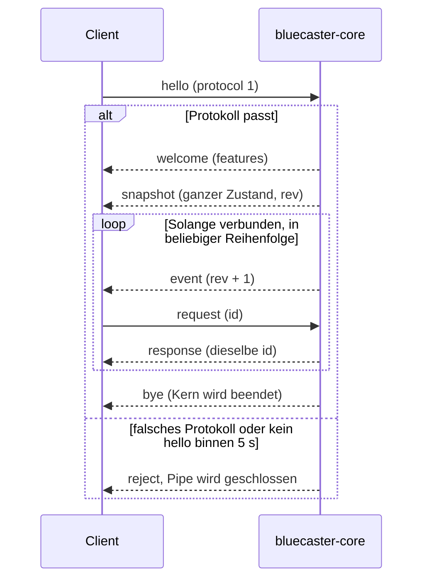

# Integration (IPC)
{: .no_toc }

So kommuniziert ein Werkzeug eines anderen Anbieters mit dem Kern von BlueCaster: Es kann den Streamstatus anzeigen, Profile starten und stoppen, die Lautstärke einstellen oder über die Bluetooth-Verbindung von BlueCaster die Dienste der Kopfhörer selbst ansprechen. Werkzeuge, die das nutzen, stehen unter [Funktioniert mit](works-with).

{: .warning }
> Das Protokoll kann sich während der 2.0.2-Betas noch ändern. Maßgeblich sind [`app/src/crates/ipc/src/protocol.rs`](https://github.com/SeiyaFunaokaJP/BlueCaster/blob/main/app/src/crates/ipc/src/protocol.rs) und die daraus erzeugten TypeScript-Typen in [`app/src/ui/src/ipc/bindings`](https://github.com/SeiyaFunaokaJP/BlueCaster/tree/main/app/src/ui/src/ipc/bindings). Diese Seite erklärt, wie Sie sie verwenden. Sie führt nicht jedes Feld auf.

## Inhalt
{: .no_toc .text-delta }

1. TOC
{:toc}

## Verbinden {#connecting}

Der Kern (`bluecaster-core.exe`) läuft, solange BlueCaster läuft, mit oder ohne Fenster. Er wartet auf einer Named Pipe für den Benutzer, unter dem er ausgeführt wird:

```
\\.\pipe\bluecaster-<user SID>
```

- `<user SID>` ist die SID-Zeichenfolge des angemeldeten Benutzers (`S-1-5-21-...`), zum Beispiel aus `whoami /user`. Jeder Benutzer hat einen eigenen Kern und eine eigene Pipe. Die DACL der Pipe lässt nur diesen Benutzer zu, und Remote-Clients werden abgewiesen.
- Die Pipe arbeitet im Byte-Modus. Mehrere Clients können gleichzeitig verbunden sein (das BlueCaster-Fenster ist einer davon). Alle erhalten denselben Zustand und dieselben Events.
- Bis 2.0.x hieß die Pipe `\\.\pipe\a2dpwb-<user SID>`. BlueCaster 3.0.0 bedient **beide** Namen, den alten noch mindestens 6 Monate nach 3.0.0. Ein Client sollte zuerst `bluecaster-<user SID>` versuchen und auf den alten Namen ausweichen. Die Protokollversion bleibt 1.
- Ob der Kern läuft, prüfen Sie anhand der Pipe, nicht anhand des Mutex des Kerns. Existiert die Pipe nicht, läuft der Kern nicht.
- Mit `BLUECASTER_INSTANCE=<name>` gestartete Entwicklungsbuilds warten stattdessen auf `\\.\pipe\bluecaster-<SID>-<name>`. So können sie neben der installierten Version laufen.

### Frames

Jede Nachricht ist in beiden Richtungen ein Frame: zuerst die Länge des JSON als **u32 little-endian**, dann das JSON selbst (UTF-8). Frames über 4 MiB werden abgewiesen.

### Handshake

1. Der Client sendet `hello` innerhalb von 5 Sekunden nach dem Verbinden:
   ```json
   {"type": "hello", "protocol": 1, "client": "mytool/1.2.0"}
   ```
   `client` ist ein frei wählbarer Name mit Version. Er erscheint im Protokoll des Kerns.
2. Der Kern antwortet mit `welcome` oder mit `reject` und schließt die Pipe (falsche Protokollversion oder kein hello):
   ```json
   {"type": "welcome", "protocol": 1, "server": "bluecaster-core/2.0.2-beta.12", "features": ["rfcomm"]}
   {"type": "reject", "reason": "protocol 2 not supported (core speaks 1)"}
   ```
3. Der Kern sendet einen `snapshot` mit seinem gesamten Zustand, danach `event`s.

Die Protokollversion muss genau übereinstimmen. Abwärtskompatible Ergänzungen werden stattdessen in `features` angekündigt (siehe [Kompatibilität](#compatibility)).



## Zustand und Events {#state-and-events}

```json
{"type": "snapshot", "rev": 41, "state": {"adapter": {...}, "devices": [...], "stream": {...}, "profiles": [...], "active_profile": "WH-1000XM5", "settings": {...}, ...}}
{"type": "event", "rev": 42, "event": {"kind": "stream", "value": {"state": "streaming", "profile": "WH-1000XM5", "info": {"codec": "ldac", "bitrate_kbps": 990, ...}, "volume": 80, ...}}}
```

Ein Client braucht keinen eigenen Zustand. Er behält den letzten Snapshot und wendet jedes Event darauf an. Jedes Zustands-Event **ersetzt einen ganzen Teil** des Snapshots:

| Event `kind` | Ersetzt |
|:--|:--|
| `adapter` | `adapter` |
| `devices` | `devices` |
| `scanning`, `le_scanning` | `scanning`, `le_scanning` |
| `stream` | `stream` (Zustand, Meldung, Profil, Codec-Informationen, Lautstärke, Akku) |
| `profiles` | `profiles` und `active_profile` |
| `settings` | `settings` |
| `update` | `update` |
| `capture` | `capture` |
| `v1_running`, `verbose`, `crashes` | das gleichnamige Feld |

`stream.state` ist eines von `idle`, `connecting`, `streaming`, `reconnecting`, `error`; `stream.message` nennt den Grund als [Meldungsschlüssel](#errors-and-messages).

**Revisionen.** Jedes Zustands-Event trägt die nächste Revision (`rev` + 1). Eine Lücke bedeutet, dass ein Event verloren gegangen ist. Fordern Sie dann mit `state.snapshot` einen neuen Snapshot an. Liest ein Client zu langsam, sendet ihm der Kern auch unaufgefordert einen neuen `snapshot`. Events, die keinen Zustand betreffen (`link`, `log`, `receiver`, `rfcomm_data`, `rfcomm_closed`), tragen die aktuelle Revision und erhöhen sie nicht.

Wenn der Kern beendet wird, sendet er das Event `bye` und schließt die Pipe.

## Anfragen {#requests}

```json
{"type": "request", "id": 7, "method": "stream.start", "params": {"profile": "WH-1000XM5"}}
{"type": "response", "id": 7, "result": null, "error": null}
```

- `id` ist eine beliebige Zahl, die der Client wählt. Die Antwort enthält dieselbe `id`. Anfragen laufen parallel, daher können Antworten in anderer Reihenfolge eintreffen.
- `params` entfällt bei Methoden ohne Parameter.
- Eine Anfrage, die den Zustand ändert, wird beantwortet, sobald die Änderung abgeschlossen ist. Die Änderung kommt außerdem als Event an. Clients sollten den Zustand anhand der Events anzeigen, nicht anhand der Antwort.

### Fehler und Meldungen {#errors-and-messages}

```json
{"type": "response", "id": 8, "result": null, "error": {"code": "rfcomm.not_connected", "message": {"key": "ipc.error.rfcomm_not_connected", "args": []}}}
```

`code` ist für Programme gedacht (`adapter.driver_missing`, `app.streaming`, ...). `message` ist ein Übersetzungsschlüssel aus den Sprachdateien von BlueCaster ([`app/lang`](https://github.com/SeiyaFunaokaJP/BlueCaster/tree/main/app/lang)) mit Argumenten im printf-Stil, wie die Statustexte im Zustand. Ein Werkzeug kann den Schlüssel dort nachschlagen oder zum Code einen eigenen Text anzeigen.

### Methoden {#methods}

Methoden für Werkzeuge:

| Methode | Parameter | Ergebnis |
|:--|:--|:--|
| `state.snapshot` | -- | `Snapshot` |
| `stream.start` | `profile` | `null`; stoppt zuerst einen laufenden Stream |
| `stream.stop` | -- | `null` |
| `stream.set_volume` | `volume` (absolute AVRCP-Lautstärke 0-127) | `null` |
| `profile.set_active` | `name` | `null` |
| `device.scan` | `seconds` (3-600) | `Device[]`, auch als Event `devices` |
| `device.scan_stop` | -- | `null`; das laufende `device.scan` gibt dann sein Ergebnis zurück |
| `audio.devices` | -- | `AudioDevice[]` (Aufnahmequellen) |
| `diag.subscribe` | `logs` (Stufe oder `null`), `link` (bool), `receiver` (bool, optional) | `null`; startet oder stoppt die Events `log` / `link` / `receiver` für diese Verbindung |
| `diag.info` | `{"mask": bool}` (optional) | `DiagInfo` (der Text von „Diagnose kopieren“) |
| `rfcomm.open`, `rfcomm.send`, `rfcomm.close` | siehe [RFCOMM-Passthrough](#rfcomm-passthrough) | |

Methoden, die das BlueCaster-Fenster verwendet und die ein Werkzeug nur mit Vorsicht einsetzen sollte: `profile.save` / `profile.delete`, `settings.set` (ersetzt **alle** Einstellungen: Senden Sie die neuesten `settings` mit Ihrer Änderung, nie ein unvollständiges Objekt), `device.forget` / `device.rename`, `adapter.*` (`adapter.assign_winusb` und `adapter.restore_driver` zeigen eine UAC-Abfrage; `adapter.probe` und `adapter.run_script`, die Chip-Werkzeuge des Entwicklermodus, halten den Bluetooth-Stack an), `app.quit`. Die übrigen Methoden dienen den Seiten des Fensters und können sich ohne Ankündigung ändern: `stream.start_custom`, die anderen `device.*`-Methoden (`device.import_windows_pairings` zeigt eine UAC-Abfrage), `audio.apps`, `audio.mixer` / `audio.mixer_set`, `diag.*` außer den beiden oben, `receiver.*` und `app.*`. Die vollständige Liste mit Parametern und Ergebnissen ist das Enum `Method` in `protocol.rs`.

## RFCOMM-Passthrough {#rfcomm-passthrough}

Verfügbar, wenn `welcome.features` `"rfcomm"` enthält (2.0.2-beta.10 und neuer). Damit erreicht ein Werkzeug die RFCOMM-Dienste der Kopfhörer (Steuer-Apps der Hersteller: Akku, Geräuschunterdrückung, EQ) über die bestehende Verbindung von BlueCaster. Windows selbst sieht Kopfhörer, die über BlueCaster verbunden sind, nicht.

- `rfcomm.open {address, uuid}` → `{channel_id, mtu}`. `address` muss das Gerät sein, an das gerade gestreamt wird. Der Kern baut dafür nie selbst eine Verbindung oder Kopplung auf (`rfcomm.not_connected`). `uuid` ist eine vollständige 128-Bit-UUID oder eine 16-Bit-`"xxxx"` auf der Bluetooth-Basis-UUID. Die Antwort kommt innerhalb von 20 s, auch wenn andere Öffnungsanfragen davor warten. Warten Sie daher mindestens 25 s. Fehler: `rfcomm.not_connected`, `rfcomm.service_not_found`, `rfcomm.open_failed`, `rfcomm.busy`.
- `rfcomm.send {channel_id, data}` → `null`. `data` ist Base64 (Standard, mit Padding), höchstens 64 KiB pro Anfrage, gesendet in Frames von höchstens `mtu` Bytes in der Reihenfolge der Anfragen. Fehler: `rfcomm.no_channel`, `rfcomm.busy` (Warteschlange voll, nicht gesendet), `rfcomm.timeout` (unklar, ob gesendet wurde: nicht wiederholen, sondern den Kanal neu öffnen).
- Empfangene Daten kommen als Events `rfcomm_data` `{channel_id, data}` an, und zwar nur bei der Verbindung, die den Kanal geöffnet hat.
- `rfcomm.close {channel_id}` → `null`, sobald die vorher gesendeten Daten übertragen sind. Es folgt kein `rfcomm_closed`.
- Ein Kanal wird auch geschlossen, wenn die Pipe-Verbindung endet, oder mit einem Event `rfcomm_closed` `{channel_id, reason}`: `remote` (das Gerät hat ihn geschlossen oder die Verbindung ist abgebrochen), `disconnected` (die A2DP-Verbindung wurde beendet), `stopped` (der Bluetooth-Stack wurde angehalten), `overflow` (der Client hat mehr als 1 MiB empfangener Daten ungelesen gelassen).

## Kompatibilität {#compatibility}

- **Features.** Prüfen Sie `welcome.features`, bevor Sie eine Ergänzung verwenden. Kerne vor 2.0.2-beta.10 lassen das Feld weg.
- **Unbekannte Anfragen.** Eine Anfrage, die der Kern nicht lesen kann (eine unbekannte Methode, fehlerhafte Parameter), wird mit dem Fehler `ipc.bad_request` beantwortet. Die Verbindung bleibt offen. Kerne vor 2.0.2-beta.10 schließen stattdessen die Verbindung. Jeder andere unlesbare Frame beendet die Verbindung.
- **Neue Felder.** Der Kern ergänzt mit der Zeit Felder im Zustand und in Events. Ignorieren Sie unbekannte Felder und weisen Sie eine Nachricht nicht deswegen zurück.
- **Umbenennung in 3.0.0** ([#193](https://github.com/SeiyaFunaokaJP/BlueCaster/issues/193)): Die Pipe wird zu `\\.\pipe\bluecaster-<SID>`. Der Kern wartet mit demselben Protokoll mindestens 6 Monate nach 3.0.0 weiterhin auch auf `\\.\pipe\a2dpwb-<SID>`. Bevor dieser Name entfernt wird, kündigen die Release Notes das an. Versuchen Sie zuerst `bluecaster-<SID>` und weichen Sie auf `a2dpwb-<SID>` aus. Der Mutex des Kerns heißt dann `Local\BlueCaster_Core`. Für denselben Zeitraum hält der Kern zusätzlich `Local\A2DPWB_v2_Core`. Beide Entfernungen werden gemeinsam angekündigt.

## Beispiel {#example}

Ein minimaler Python-Client (nur Standardbibliothek), der den Streamstatus ausgibt und dessen Änderungen verfolgt:

```python
import json, struct, subprocess

sid = subprocess.run(["whoami", "/user", "/fo", "csv", "/nh"],
                     capture_output=True, text=True).stdout.strip().split(",")[1].strip('"')
pipe = open(rf"\\.\pipe\bluecaster-{sid}", "r+b", buffering=0)

def send(msg):
    b = json.dumps(msg).encode()
    pipe.write(struct.pack("<I", len(b)) + b)

def read_exact(n):
    buf = b""
    while len(buf) < n:
        chunk = pipe.read(n - len(buf))
        if not chunk:
            raise EOFError
        buf += chunk
    return buf

def recv():
    (n,) = struct.unpack("<I", read_exact(4))
    return json.loads(read_exact(n))

send({"type": "hello", "protocol": 1, "client": "example/0.1"})
welcome = recv()
assert welcome["type"] == "welcome", welcome
snap = recv()
print("stream:", snap["state"]["stream"]["state"])
while True:
    m = recv()
    if m["type"] == "event" and m["event"]["kind"] == "stream":
        s = m["event"]["value"]
        print("stream:", s["state"], (s.get("info") or {}).get("codec"))
    elif m["type"] == "event" and m["event"]["kind"] == "bye":
        break
```

Um ein Werkzeug auszuprobieren, ohne das installierte BlueCaster zu beeinflussen, starten Sie einen Entwicklungsbuild mit gesetztem `BLUECASTER_INSTANCE` und `BLUECASTER_CONFIG_DIR` (siehe [Bauen](building)) und verbinden Sie sich mit dessen Pipe.
