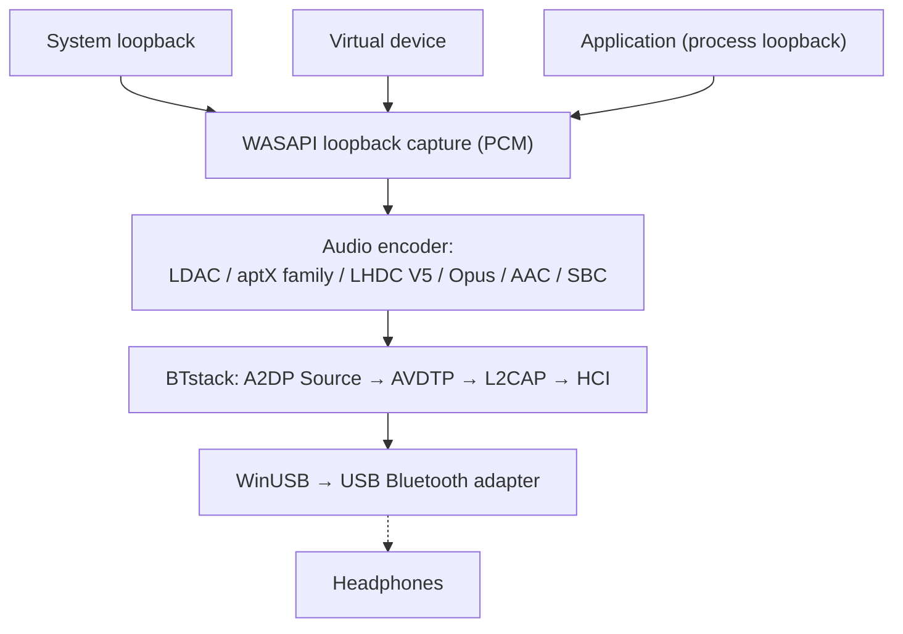

# BlueCaster

Advanced Bluetooth Audio Transmitter for Windows, with full codec support.
{: .fs-6 .fw-300 }

BlueCaster turns your Bluetooth adapter into a Hi-Fi audio transmitter. It streams Hi-Fi codecs like **LDAC@96 kHz**, **LHDC V5@192 kHz** and **aptX Adaptive** to your headphones and earbuds. Windows doesn't support any of these codecs on its own. BlueCaster also supports aptX HD, aptX, aptX Low Latency, Opus, AAC, SBC XQ, SBC and FastStream.

- **Works with the Bluetooth you already have.** The built-in Intel, Realtek or MediaTek Bluetooth on many laptops works, and so does an inexpensive USB dongle. BlueCaster takes over the adapter, and one click gives it back to Windows.
- **A headset mic that stays out of the way.** The mic turns on only while an app is recording, so your music plays at full quality the rest of the time. Noise suppression and gain control are built in.
- **No extra tools needed.** BlueCaster sets up the adapter right in the app ([how it works](architecture)).

[Get Started](setup){: .btn .btn-primary .fs-5 .mb-4 .mb-md-0 .mr-2 }
[GitHub](https://github.com/SeiyaFunaokaJP/BlueCaster){: .btn .fs-5 .mb-4 .mb-md-0 }

---

## Supported Codecs

| Codec | Bitrate | Sample Rate | Bit Depth | Latency |
|:------|:--------|:------------|:----------|:--------|
| LHDC V5 | 400/500/900/1000 kbps, ABR 160--400 kbps | 44.1/48/96/192 kHz | 16/24 bit | -- |
| LDAC | 330/660/990 kbps | 44.1--96 kHz | 16/24/32 bit | ~200 ms |
| aptX Adaptive | 265/427 kbps (96 kHz: 646) | 48/96 kHz | 24 bit | -- |
| Opus | 256 kbps | 48 kHz | 16 bit | -- |
| aptX HD | 576 kbps | 44.1/48 kHz | 24 bit | ~150 ms |
| aptX | 352/384 kbps | 44.1/48 kHz | 16 bit | -- |
| aptX Low Latency | 352 kbps | 44.1/48 kHz | 16 bit | ~32 ms |
| AAC | up to 256 kbps | 44.1/48 kHz | 16 bit | ~150 ms |
| SBC XQ | ~385/505/552 kbps | 44.1/48 kHz | 16 bit | ~150 ms |
| SBC | up to ~345 kbps | 44.1/48 kHz | 16 bit | ~150 ms |
| FastStream | 198/216 kbps | 44.1/48 kHz | 16 bit | -- |
| Opus 05 | 256 kbps | 48 kHz | 16 bit | -- |
| LC3 (LE Audio) 🧪 | 32--124 kbps per channel | 16/24/32/48 kHz | 16 bit | ~140 ms |
| LC3 LL (LE Audio GMAP) 🧪 | 64--96 kbps per channel | 32/48 kHz | 16 bit | ~30 ms |

### Codec Support by Platform (Sending to Headphones)

| Codec | Windows 10 built-in | Windows 11 built-in | Ubuntu built-in (PipeWire) | **BlueCaster** (Windows 10 / 11) |
|:------|:-------------------:|:-------------------:|:--------------------------:|:----------------------------:|
| LHDC V5 | ❌ | ❌ | ❌ | ✅ |
| LDAC | ❌ | ❌ | ✅ | ✅ |
| aptX Adaptive | ❌ | ❌ | ❌ | ✅ |
| Opus (Android's A2DP Opus) | ❌ | ❌ | ✅ PipeWire 1.2+ (`opus_g`); not in Ubuntu 24.04 (PipeWire 1.0.5) | ✅ |
| aptX HD | ❌ | ❌ | ✅ | ✅ |
| aptX | ✅ | ✅ | ✅ | ✅ |
| aptX Low Latency | ❌ | ❌ | ✅ | ✅ |
| AAC | ❌ | ✅ | ❌ not in Ubuntu's packages | ✅ |
| SBC XQ | ❌ | ❌ | ✅ | ✅ (sinks whose SBC allows dual channel, bitpool ≥ 29) |
| SBC | ✅ | ✅ | ✅ | ✅ |
| FastStream | ❌ | ❌ | ✅ | ✅ (music only, chosen explicitly) |
| Opus 05 (PipeWire's own Opus) | ❌ | ❌ | ✅ PipeWire 0.3.57+ (`opus_05`, to PipeWire devices only) | ✅ (chosen explicitly, developer mode only) |
| LC3 (LE Audio, BAP unicast) | ❌ | ✅ on PCs whose Bluetooth hardware and driver support LE Audio | ✅ PipeWire BAP `lc3` (BlueZ LE Audio) | 🧪 experimental, developer mode only (a device's LE Audio entry; GMAP low latency with gaming headsets; Bluetooth 5.2 adapter with ISO, [Usage](usage#le-audio)) |

✅ supported · 🧪 experimental · ❌ not supported. All columns show the sending side (PC → headphones). "Built-in" means the OS's own Bluetooth audio, without BlueCaster; the Ubuntu column shows the PipeWire codec set of Ubuntu 26.04 (`libspa-0.2-bluetooth`).

{: .warning }
**aptX HD and aptX Low Latency** follow the Android / PipeWire implementations and pass encode/decode round-trip tests, but have not yet been verified with real headphones. Latency values in this table are typical figures, not measured with BlueCaster.

{: .warning }
**About LHDC V5.** BlueCaster uses a C port of the LHDC V5 encoder that Google added to Android 17 (AOSP, Apache-2.0). The port's output is bit-exact with the AOSP Rust encoder, and the A2DP signaling follows Android's `a2dp_vendor_lhdcv5`. A user confirmed LHDC V5 with real LHDC V5 headphones at 1000 kbps / 192 kHz on v1.1.1-beta.1 ([#50](https://github.com/SeiyaFunaokaJP/BlueCaster/issues/50)); v2 uses the same encoder. Only lossy LHDC V5 is supported: LHDC V2/V3 (older headphones) and the lossless "LHDC-RAW" mode have no open-source encoder. In Auto mode LHDC V5 ranks first, above LDAC.

{: .warning }
**Opus** is Android's A2DP Opus vendor codec (Android 13+, vendor ID 0x000000E0 Google): 48 kHz, 20 ms frames, 256 kbps stereo as Android requests it (Standard 192, Mobile 128 kbps), encoded with libopus 1.6.1. It passes the end-to-end test against a virtual sink, but has not yet been verified with real Opus headphones. In Auto mode it ranks below aptX Adaptive and above aptX HD.

{: .warning }
**Opus 05** is PipeWire's own A2DP Opus vendor codec (vendor ID 0x000005F1, codec 0x1005; PipeWire `opus_05`), which only PipeWire implements, so the receiver has to be a PC running PipeWire as an A2DP sink. BlueCaster sends stereo music only (no 5.1 / 7.1, no return channel): 48 kHz, 10 ms frames (20 ms if the sink has only that), the same libopus encoder and bit rates as Opus, capped at the sink's limit. Auto never picks it; choose it on **Codecs** or with `-c opus05`. It passes the end-to-end test against a virtual sink that offers PipeWire's capabilities, but has not been tried with a real PipeWire receiver. As an A2DP sink, PipeWire has decoded Opus 05 since 0.3.57 and Android's Opus (`opus_g`) since 1.2.0. Ubuntu 24.04 LTS ships PipeWire 1.0.5 (Opus 05 only); Ubuntu 25.10 (1.4.7) and 26.04 LTS (1.6.2) ship both. Neither codec has been tested with BlueCaster yet.

{: .warning }
**SBC XQ** was verified with a Sony WH-1000XM4 (dual channel, bitpool 43 at 48 kHz, 552 kbps). If a sink refuses that configuration, BlueCaster reconnects with plain SBC. **FastStream** passes the end-to-end test against a virtual sink but has not been tried with real FastStream headphones. It carries music only, and Auto never picks it.

{: .note }
**Only need classic aptX?** Windows 10 already supports classic aptX in its built-in Bluetooth stack (not aptX HD, aptX LL or aptX Adaptive), so BlueCaster is not required for it. BlueCaster is mainly useful for LHDC V5, LDAC, aptX Adaptive, aptX HD and aptX Low Latency.

{: .note }
**About aptX Adaptive.** BlueCaster encodes it with the MIT-licensed pure-Rust encoder from [AKS-Logic/aptx-adaptive-linux](https://github.com/AKS-Logic/aptx-adaptive-linux); its authors reconstructed the encoder's tables from shipped Qualcomm binaries and on-air captures. 48 kHz stereo (44.1 kHz requests are captured at 48 kHz), 24-bit: High 427 kbps or Low Latency 265 kbps (R2 sinks: 270), ABR in High. 96 kHz (High, 646 kbps) is used when you choose it in the codec's settings and the headphones are an R2 sink that lists 96 kHz; Low Latency never uses it, and Auto streams 48 kHz. Auto ranks aptX Adaptive after LHDC V5 and LDAC; you can also choose it on **Codecs** or with `-c aptxad`. A user confirmed it on an EarFun Air Pro 4+ at 48 kHz on 2.0.2-beta.6 (as stable as classic aptX), and has since confirmed 96 kHz on real headphones ([#86](https://github.com/SeiyaFunaokaJP/BlueCaster/issues/86)); upstream reports it working on Linux with Bose QuietComfort Ultra (gen 1) and B&W Px7 S2e. See [aptX Family and aptX Adaptive](usage#aptx-compatibility).

## Platform Support

| Component | Windows 10 (x64 / ARM64) | Windows 11 (x64 / ARM64) | Linux (Ubuntu) |
|:----------|:----------------:|:----------------:|:--------------:|
| **BlueCaster** (window, tray, CLI) | ✅ (not yet tried on real hardware) | ✅ | ❌ |
| [Building from source](building) (Rust, Visual Studio 2022+) | ✅ | ✅ | ❌ |
| `bluecaster_decode` (stream checker) | ✅ | ✅ | ❌ |
| End-to-end test `tools/emu/run_test.py` | ✅ | ✅ | ❌ |
| Virtual adapter `tools/emu/emu_vhci.py` | ❌ | ❌ | ✅ |
| [Measuring receiver](usage#receiver) `tools/linux_sink` | ❌ | ❌ | ✅ |

BlueCaster itself runs on Windows only (Windows 10 or Windows 11), built for x64 and ARM64. The Linux tools need Python 3.11 or later (verified on Ubuntu 26.04); `setup.sh` targets Ubuntu / Debian, and other distributions need the packages installed by hand.

## Verified Hardware

Tested with Sony WH-1000XM4 and WH-1000XM6, EarFun Air Pro 4+, Grado GW100x and more, on TP-Link UB500, generic RTL8761B, a laptop's built-in RTL8852BE, ASUS BT400 and CSR8510 adapters. **[Verified Hardware](hardware)** has the full list, with codecs, versions and the reports behind each entry.

## Dropouts and Connection Problems

**[Dropouts and Connection Problems](wireless)** covers what past dropout and connection reports turned out to be, the checks to run before you report, and how to read Link Quality.

## Works With

**[Works With](works-with)** lists third-party apps, such as earbud control apps, that users report working with BlueCaster. BlueCaster does not make or support them.

## Audio Capture Modes

BlueCaster captures audio via WASAPI and offers three modes:

| Mode | Description | Use Case |
|:-----|:------------|:---------|
| **Default device** | Captures all system audio output from the default playback device | Simple setup -- all sounds are streamed |
| **Virtual Device** | Captures from a user-selected virtual audio device (e.g., VB-CABLE, VoiceMeeter) | Route specific apps to Bluetooth while keeping other audio on speakers |
| **Application** | Captures only what one app plays, after its own processing (Windows 11 / Windows 10 2004+) | Send one app, or the output of a system-wide effects app (equalizer, sound enhancer) |

In **Virtual Device** mode, BlueCaster can make the selected virtual device the Windows default playback device (**Set as Windows default output while connected**) and then captures its loopback output. Any app that plays to the virtual device is streamed over Bluetooth. When streaming stops, the previous default device is restored.

The **Default device** source does not take the audio away from the default playback device: the sound plays there as well as over Bluetooth. If the selected virtual device cannot be opened, BlueCaster sends the system audio instead and tells you. See [Capture Modes](usage#capture-modes).

## How It Works

BlueCaster bypasses the Windows Bluetooth stack entirely. It communicates directly with a USB Bluetooth adapter through WinUSB, using [BTstack](https://github.com/bluekitchen/btstack) to implement the full Bluetooth protocol stack in user mode. A small background program (`bluecaster-core.exe`, with the tray icon) streams the audio; the window only displays its state, so closing the window does not stop the audio (see [Architecture](architecture)).

## Features

- **Multi-codec**: LHDC V5, LDAC, aptX Adaptive, aptX, AAC, aptX HD, aptX Low Latency, Opus, Opus 05, FastStream, SBC XQ and SBC with automatic negotiation
- **LE Audio (experimental, developer mode only)**: LC3 to LE Audio headphones and earbuds (BAP unicast, both earbuds of a pair, headset volume, media buttons, GMAP low latency). Needs an adapter with Bluetooth 5.2 isochronous channels. LE Audio does not work reliably on real adapters yet, including the MediaTek MT7925 ([Usage](usage#le-audio))
- **Three capture modes**: System loopback, virtual audio device routing, or one application's output
- **Window, tray and CLI**: a window for setup and diagnostics, a tray flyout and menu for everyday connecting, and a command line (see [Usage](usage))
- **WinUSB in the app**: assigns the WinUSB driver to the adapter and restores the original driver, no Zadig needed (see [Setup](setup#winusb)); headphones that Windows paired through the adapter connect without pairing again
- **First-run setup**: adapter, driver and firmware, headphones, a first connection, general settings
- **ABR**: Adaptive Bit Rate for unstable connections (LDAC, LHDC V5 and aptX Adaptive; adaptive bitpool for SBC and SBC XQ)
- **Auto-reconnect**: Reconnects after a lost link (3 attempts; 10 when the adapter has to start again) and after the PC resumes from sleep; turn it off with **Reconnect automatically** on **Audio Devices**
- **Link quality and AFH**: Shows what is sent, the RSSI and the channels in use; tells the adapter which Wi-Fi channels to avoid (see [Usage](usage#link-quality))
- **Headphone controls (AVRCP)**: Volume slider synced with the headphones and the Windows volume; the headphones' play/pause, next and previous buttons control playback on the PC (see [Usage](usage#headphone-buttons))
- **Per-device settings**: each audio device has its own codec (with its settings) and output source, shown side by side on Home and connectable from the tray
- **Updates**: The installed version updates automatically once the audio device disconnects (see [Usage](usage#updates))
- **Localization**: English, Japanese, Simplified / Traditional Chinese, Korean, German, French, Spanish, Ukrainian and Russian
- **Realtek firmware**: Guided firmware download for Realtek adapters
- **Diagnostics**: connection flow, log, HCI capture, diagnostics for bug reports, peer receiver test against a Linux PC (see [Usage](usage#receiver))
