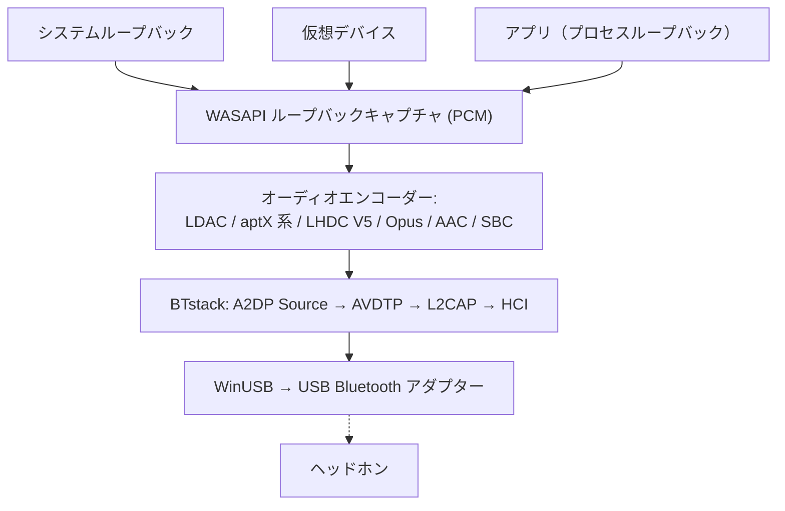

# BlueCaster

Windows 向け Bluetooth A2DP オーディオストリーミングツール（全コーデック対応）
{: .fs-6 .fw-300 }

BlueCaster は、お使いの Bluetooth アダプターを Hi-Fi オーディオトランスミッターに変えます。**LDAC@96 kHz**、**LHDC V5@192 kHz**、**aptX Adaptive** などの Hi-Fi コーデックで、ヘッドホンやイヤホンに音声を送信できます。これらのコーデックは Windows 単体では使えません。ほかに aptX HD・aptX・aptX Low Latency・Opus・AAC・SBC XQ・SBC・FastStream にも対応しています。

- **今ある Bluetooth をそのまま使えます。** 多くのノート PC に内蔵されている Intel・Realtek・MediaTek の Bluetooth でも、手ごろな USB ドングルでも動作します。BlueCaster はアダプターを専用で使いますが、ワンクリックで Windows に戻せます。
- **必要なときだけ動くヘッドセットマイク。** マイクはアプリが録音している間だけオンになるので、それ以外の時間は音楽を本来の音質で聴けます。ノイズ抑制とゲイン調整も備えています。
- **追加のツールは不要です。** BlueCaster がアプリの中でアダプターを準備します（[仕組み](architecture)）。

[セットアップ](setup){: .btn .btn-primary .fs-5 .mb-4 .mb-md-0 .mr-2 }
[GitHub](https://github.com/SeiyaFunaokaJP/BlueCaster){: .btn .fs-5 .mb-4 .mb-md-0 }

---

## 対応コーデック

| コーデック | ビットレート | サンプルレート | ビット深度 | レイテンシー |
|:-----------|:-------------|:---------------|:-----------|:-------------|
| LHDC V5 | 400/500/900/1000 kbps、ABR 160--400 kbps | 44.1/48/96/192 kHz | 16/24 bit | -- |
| LDAC | 330/660/990 kbps | 44.1--96 kHz | 16/24/32 bit | 約 200 ms |
| aptX Adaptive | 265/427 kbps（96 kHz: 646） | 48/96 kHz | 24 bit | -- |
| Opus | 256 kbps | 48 kHz | 16 bit | -- |
| aptX HD | 576 kbps | 44.1/48 kHz | 24 bit | 約 150 ms |
| aptX | 352/384 kbps | 44.1/48 kHz | 16 bit | -- |
| aptX Low Latency | 352 kbps | 44.1/48 kHz | 16 bit | 約 32 ms |
| AAC | 最大 256 kbps | 44.1/48 kHz | 16 bit | 約 150 ms |
| SBC XQ | 約 385/505/552 kbps | 44.1/48 kHz | 16 bit | 約 150 ms |
| SBC | 最大約 345 kbps | 44.1/48 kHz | 16 bit | 約 150 ms |
| FastStream | 198/216 kbps | 44.1/48 kHz | 16 bit | -- |
| Opus 05 | 256 kbps | 48 kHz | 16 bit | -- |
| LC3（LE Audio） 🧪 | 1 チャネルあたり 32--124 kbps | 16/24/32/48 kHz | 16 bit | 約 140 ms |
| LC3 LL（LE Audio GMAP） 🧪 | 1 チャネルあたり 64--96 kbps | 32/48 kHz | 16 bit | 約 30 ms |

### プラットフォーム別のコーデック対応（ヘッドホンへの送信）

| コーデック | Windows 10 標準 | Windows 11 標準 | Ubuntu 標準（PipeWire） | **BlueCaster**（Windows 10 / 11） |
|:-----------|:---------------:|:---------------:|:-----------------------:|:-----------------------------:|
| LHDC V5 | ❌ | ❌ | ❌ | ✅ |
| LDAC | ❌ | ❌ | ✅ | ✅ |
| aptX Adaptive | ❌ | ❌ | ❌ | ✅ |
| Opus（Android の A2DP Opus） | ❌ | ❌ | ✅ PipeWire 1.2 以降（`opus_g`）。Ubuntu 24.04（PipeWire 1.0.5）にはない | ✅ |
| aptX HD | ❌ | ❌ | ✅ | ✅ |
| aptX | ✅ | ✅ | ✅ | ✅ |
| aptX Low Latency | ❌ | ❌ | ✅ | ✅ |
| AAC | ❌ | ✅ | ❌ Ubuntu のパッケージに含まれない | ✅ |
| SBC XQ | ❌ | ❌ | ✅ | ✅（SBC でデュアルチャネルと bitpool 29 以上を受け付けるシンク） |
| SBC | ✅ | ✅ | ✅ | ✅ |
| FastStream | ❌ | ❌ | ✅ | ✅（音楽のみ。手動で選んだ場合） |
| Opus 05（PipeWire 独自の Opus） | ❌ | ❌ | ✅ PipeWire 0.3.57 以降（`opus_05`、相手も PipeWire の場合のみ） | ✅（手動で選んだ場合。開発者モードのみ） |
| LC3（LE Audio、BAP ユニキャスト） | ❌ | ✅ Bluetooth のハードウェアとドライバーが LE Audio に対応した PC のみ | ✅ PipeWire の BAP `lc3`（BlueZ の LE Audio） | 🧪 実験的、開発者モードのみ（デバイスの LE Audio の項目。ゲーミングヘッドセットでは GMAP の低遅延。ISO 対応の Bluetooth 5.2 アダプターが必要。[使い方](usage#le-audio)） |

✅ 対応 · 🧪 実験的 · ❌ 非対応。どの列も送信側（PC → ヘッドホン）の対応状況です。「標準」は、BlueCaster を使わない OS 自身の Bluetooth オーディオを指します。Ubuntu の列は、Ubuntu 26.04 の PipeWire（`libspa-0.2-bluetooth`）が対応するコーデックです。

{: .warning }
**aptX HD・aptX Low Latency** は Android / PipeWire の実装に準拠しており、エンコード→デコードの往復テストには合格していますが、実機のヘッドホンではまだ検証していません。表のレイテンシーは一般的な目安で、BlueCaster で測定した値ではありません。

{: .warning }
**LHDC V5 について。** BlueCaster は、Google が Android 17（AOSP、Apache-2.0）に追加した LHDC V5 エンコーダーの C 移植版を使っています。移植版の出力は AOSP の Rust 版エンコーダーとビット単位で一致し、A2DP のシグナリングは Android の `a2dp_vendor_lhdcv5` に準拠しています。実機の LHDC V5 ヘッドホンでは、v1.1.1-beta.1 で 1000 kbps / 192 kHz での動作がユーザーにより確認されています（[#50](https://github.com/SeiyaFunaokaJP/BlueCaster/issues/50)）。v2 も同じエンコーダーを使います。対応するのはロッシーの LHDC V5 だけです。LHDC V2/V3（従来のヘッドホン）とロスレスの「LHDC-RAW」モードには、オープンソースのエンコーダーがありません。自動選択では LHDC V5 が最上位で、LDAC より優先されます。

{: .warning }
**Opus** は Android の A2DP Opus ベンダーコーデック（Android 13 以降、ベンダー ID 0x000000E0 Google）です。48 kHz、20 ms フレーム、ステレオ 256 kbps（Android が要求する値。標準 192 kbps、モバイル 128 kbps）で、libopus 1.6.1 でエンコードします。仮想シンクとのエンドツーエンドテストには合格していますが、実際の Opus 対応ヘッドホンでは未確認です。自動選択での優先度は aptX Adaptive の次、aptX HD の前です。

{: .warning }
**Opus 05** は PipeWire 独自の A2DP Opus ベンダーコーデック（ベンダー ID 0x000005F1、コーデック ID 0x1005、PipeWire の `opus_05`）です。実装しているのは PipeWire だけなので、受信側は A2DP シンクとして動作する PipeWire の PC に限られます。BlueCaster が送るのはステレオの音楽だけです（5.1 / 7.1 や戻りの音声はなし）。48 kHz、10 ms フレーム（シンクが 20 ms にしか対応しない場合は 20 ms）で、エンコーダーとビットレートは Opus と同じです。ビットレートはシンクの上限までに抑えます。自動選択では選ばれないので、**コーデック** 画面か `-c opus05` で選んでください。PipeWire と同じ能力を持つ仮想シンクとのエンドツーエンドテストには合格していますが、実際の PipeWire ではまだ試していません。A2DP シンクとしての PipeWire は、Opus 05 を 0.3.57 から、Android の Opus（`opus_g`）を 1.2.0 からデコードできます。Ubuntu 24.04 LTS の PipeWire 1.0.5 は Opus 05 のみ、Ubuntu 25.10（1.4.7）と 26.04 LTS（1.6.2）は両方に対応しています。どちらのコーデックも、BlueCaster ではまだ確認していません。

{: .warning }
**SBC XQ** は Sony WH-1000XM4 で確認済みです（デュアルチャネル、48 kHz で bitpool 43、552 kbps）。この設定を拒否するシンクには、BlueCaster が通常の SBC で接続し直します。**FastStream** は仮想シンクとのエンドツーエンドテストには合格していますが、実際の FastStream 対応ヘッドホンではまだ試していません。送れるのは音楽だけで、自動選択では選ばれません。

{: .note }
**クラシック aptX だけが必要なら**、Windows 10 標準の Bluetooth スタックがクラシック aptX に対応しているので（aptX HD・aptX LL・aptX Adaptive は非対応）、BlueCaster は不要です。BlueCaster が主に役立つのは、LHDC V5・LDAC・aptX Adaptive・aptX HD・aptX Low Latency です。

{: .note }
**aptX Adaptive について。** [AKS-Logic/aptx-adaptive-linux](https://github.com/AKS-Logic/aptx-adaptive-linux) の、MIT ライセンスで純 Rust 製のエンコーダーを使っています。エンコーダーのテーブルは、作者が Qualcomm の製品に含まれるバイナリと無線のキャプチャから再構成したものです。48 kHz ステレオ（44.1 kHz を指定しても 48 kHz で取り込みます）、24 bit で、高音質 427 kbps か低遅延 265 kbps（R2 のシンクでは 270 kbps）です。高音質では ABR が使えます。96 kHz（高音質、646 kbps）は、コーデックの設定で 96 kHz を選び、ヘッドホンが 96 kHz を通知する R2 のシンクである場合に使います。低遅延では使わず、自動では 48 kHz で送ります。自動選択では LHDC V5、LDAC の次に選ばれます。**コーデック** 画面か `-c aptxad` で選ぶこともできます。2.0.2-beta.6 で、EarFun Air Pro 4+ での 48 kHz の動作がユーザーにより確認されました（クラシック aptX と同程度に安定）。その後、96 kHz も実際のヘッドホンで確認されています（[#86](https://github.com/SeiyaFunaokaJP/BlueCaster/issues/86)）。上流のプロジェクトは、Linux で Bose QuietComfort Ultra（第 1 世代）と B&W Px7 S2e での動作を報告しています。詳しくは [aptX ファミリーと aptX Adaptive](usage#aptx-compatibility)を参照してください。

## 対応プラットフォーム {#platform-support}

| コンポーネント | Windows 10 (x64 / ARM64) | Windows 11 (x64 / ARM64) | Linux (Ubuntu) |
|:---------------|:----------------:|:----------------:|:--------------:|
| **BlueCaster**（ウィンドウ / トレイ / CLI） | ✅（実機では未確認） | ✅ | ❌ |
| [ソースからのビルド](building)（Rust、Visual Studio 2022 以降） | ✅ | ✅ | ❌ |
| `bluecaster_decode`（ストリーム検査ツール） | ✅ | ✅ | ❌ |
| エンドツーエンドテスト `tools/emu/run_test.py` | ✅ | ✅ | ❌ |
| 仮想アダプター `tools/emu/emu_vhci.py` | ❌ | ❌ | ✅ |
| [測定用受信機](usage#receiver) `tools/linux_sink` | ❌ | ❌ | ✅ |

BlueCaster 本体は Windows 専用（Windows 10 22H2 または Windows 11）で、x64 版と ARM64 版があります。Linux 側のツールには Python 3.11 以降が必要です（Ubuntu 26.04 で確認済み）。`setup.sh` は Ubuntu / Debian 向けです。ほかのディストリビューションでは、パッケージを手動でインストールしてください。

## 検証済みの機器 {#verified-hardware}

Sony WH-1000XM4・WH-1000XM6、EarFun Air Pro 4+、Grado GW100x などを、TP-Link UB500、汎用 RTL8761B、ノート PC 内蔵の RTL8852BE、ASUS BT400、CSR8510 のアダプターで確認しています。コーデック、バージョン、各項目の元になった報告を含む一覧は、**[検証済みの機器](hardware)** にあります。

## 音切れと接続の問題

**[音切れと接続の問題](wireless)** では、音切れや接続についての過去の報告の原因、報告する前に行う確認、通信品質の読み方を説明しています。

## 連携するツール

**[連携するツール](works-with)** には、イヤホンの操作アプリなど、BlueCaster と組み合わせて動作するとユーザーから報告されたサードパーティのアプリを載せています。これらは BlueCaster が開発やサポートをしているものではありません。

## オーディオキャプチャモード

BlueCaster は WASAPI で音声をキャプチャします。キャプチャのモードは 3 つあります。

| モード | 説明 | 用途 |
|:-------|:-----|:-----|
| **既定のデバイス** | 既定の再生デバイスから、システムのすべての音声をキャプチャ | シンプルな構成。すべての音声を配信 |
| **仮想デバイス** | 選んだ仮想オーディオデバイス（VB-CABLE、VoiceMeeter など）からキャプチャ | 特定のアプリだけを Bluetooth に送り、ほかの音声はスピーカーから出す |
| **アプリ** | 1 つのアプリが再生する音だけを、そのアプリ自身の処理の後でキャプチャ（Windows 11 / Windows 10 2004 以降） | 1 つのアプリだけを送る。またはシステム全体のエフェクトアプリ（イコライザー、音質補正など）の出力を送る |

**仮想デバイス**モードでは、選んだ仮想デバイスを Windows の既定の再生デバイスにすることもでき（**接続中は Windows の既定の出力にする**）、そのループバック出力をキャプチャします。仮想デバイスに出力するアプリの音声は、すべて Bluetooth で配信されます。配信を止めると、既定のデバイスは元に戻ります。

**既定のデバイス**では、既定の再生デバイスの音声はそのまま残るので、音は Bluetooth とそのデバイスの両方から出ます。選んだ仮想デバイスを開けないときは、BlueCaster が代わりにシステムの音声を送り、そのことを知らせます。詳しくは[キャプチャモード](usage#capture-modes)を参照してください。

## 動作の仕組み

BlueCaster は Windows の Bluetooth スタックをまったく使いません。WinUSB を通して USB Bluetooth アダプターと直接通信し、[BTstack](https://github.com/bluekitchen/btstack) で Bluetooth プロトコルスタック全体をユーザーモードで動かします。音声を送るのは小さな常駐プログラム（`bluecaster-core.exe`、トレイのアイコン付き）です。ウィンドウはその状態を表示するだけなので、ウィンドウを閉じても音は止まりません（[アーキテクチャ](architecture)を参照）。

## 主な機能

- **マルチコーデック**: LHDC V5、LDAC、aptX Adaptive、aptX、AAC、aptX HD、aptX Low Latency、Opus、Opus 05、FastStream、SBC XQ、SBC（接続時に自動でネゴシエーション）
- **LE Audio（実験的、開発者モードのみ）**: LE Audio のヘッドホン・イヤホンへ LC3 で送信（BAP ユニキャスト、左右一組のイヤホン、ヘッドセットの音量、メディアボタン、GMAP の低遅延）。Bluetooth 5.2 のアイソクロナスチャネルに対応したアダプターが必要です。実際のアダプターでは、MediaTek MT7925 も含めてまだ安定して動作しません（[使い方](usage#le-audio)を参照）
- **3 つのキャプチャモード**: システムループバック、仮想オーディオデバイス経由のルーティング、1 つのアプリの出力
- **ウィンドウ・トレイ・CLI**: セットアップと診断にはウィンドウ、毎日の接続にはトレイのフライアウトとメニューを使えます。コマンドラインもあります（[使い方](usage)を参照）
- **アプリ内で WinUSB を割り当て**: アダプターに WinUSB ドライバーを割り当て、元のドライバーに戻すこともできます。Zadig は不要です（[セットアップ](setup#winusb)を参照）。Windows がこのアダプター経由でペアリングしたヘッドホンは、ペアリングし直さずに接続できます
- **初回セットアップ**: アダプター、ドライバーとファームウェア、ヘッドホン、最初の接続、全般設定
- **ABR**: 接続が不安定なときにビットレートを自動調整（LDAC、LHDC V5、aptX Adaptive。SBC と SBC XQ は bitpool を調整）
- **自動再接続**: 接続が切れたときと、PC がスリープから復帰したときに再接続します（3 回。アダプターを起動し直す必要があるときは 10 回）。**オーディオデバイス** の **自動で再接続する** でオフにできます
- **通信品質と AFH**: 送信内容、RSSI、使用中のチャネルを表示し、避けるべき Wi-Fi チャネルをアダプターに伝えます（[使い方](usage#link-quality)を参照）
- **ヘッドホン操作（AVRCP）**: 音量スライダーはヘッドホンと Windows の音量に連動します。ヘッドホンの再生/一時停止、曲送り、曲戻しのボタンで PC の再生を操作できます（[使い方](usage#headphone-buttons)を参照）
- **デバイスごとの設定**: オーディオデバイスごとにコーデック（とその設定）と出力ソースを保存します。デバイスはホームに並べて表示され、トレイからも接続できます
- **更新**: インストーラー版は、オーディオデバイスが切断されたときに自動で更新します（[使い方](usage#updates)を参照）
- **多言語対応**: 英語、日本語、中国語（簡体字 / 繁体字）、韓国語、ドイツ語、フランス語、スペイン語、ウクライナ語、ロシア語
- **Realtek ファームウェア**: Realtek アダプター向けに、ファームウェアのダウンロードを案内
- **診断**: 接続の流れ、ログ、HCI キャプチャ、不具合報告用の診断情報、Linux PC を使った対向受信テスト（[使い方](usage#receiver)を参照）
