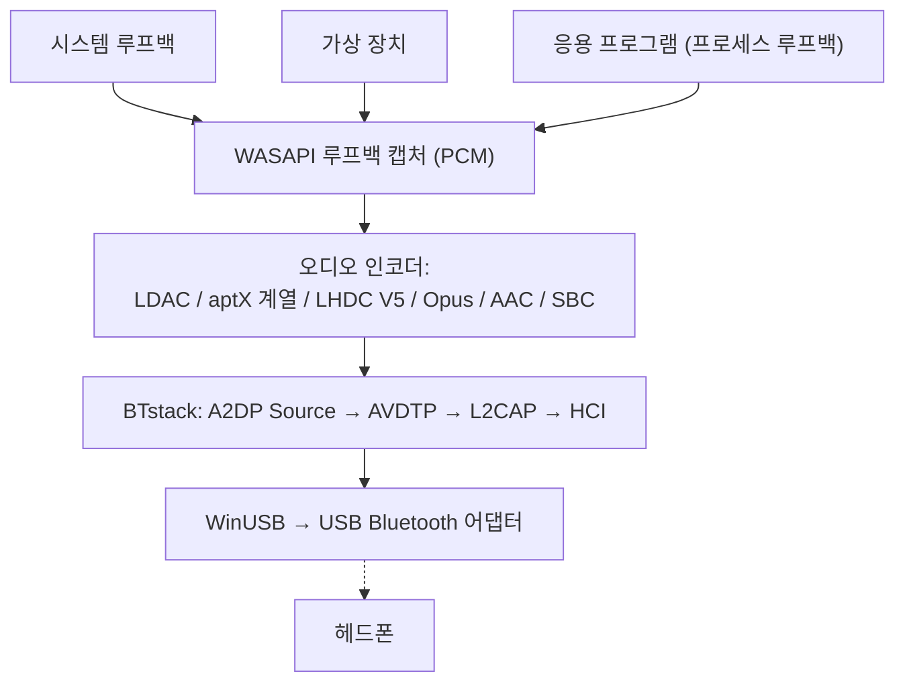

# BlueCaster

모든 코덱을 지원하는 Windows용 고급 Bluetooth 오디오 송신기
{: .fs-6 .fw-300 }

BlueCaster는 Bluetooth 어댑터를 Hi-Fi 오디오 송신기로 바꿔 줍니다. **LDAC@96 kHz**, **LHDC V5@192 kHz**, **aptX Adaptive** 같은 Hi-Fi 코덱으로 헤드폰과 이어폰에 음악을 전송합니다. Windows 자체로는 이 코덱들을 사용할 수 없습니다. 그 밖에 aptX HD, aptX, aptX Low Latency, Opus, AAC, SBC XQ, SBC, FastStream도 지원합니다.

- **지금 가진 Bluetooth를 그대로 사용합니다.** 많은 노트북에 내장된 Intel, Realtek, MediaTek Bluetooth도, 저렴한 USB 동글도 사용할 수 있습니다. BlueCaster가 어댑터를 전용으로 사용하며, 클릭 한 번으로 Windows에 되돌릴 수 있습니다.
- **필요할 때만 켜지는 헤드셋 마이크.** 앱이 녹음하는 동안에만 마이크가 켜지므로, 그 밖의 시간에는 음악을 원래 음질로 들을 수 있습니다. 소음 억제와 게인 조절 기능도 들어 있습니다.
- **별도의 도구가 필요 없습니다.** BlueCaster가 앱 안에서 어댑터를 설정합니다([작동 방식](architecture)).

[시작하기](setup){: .btn .btn-primary .fs-5 .mb-4 .mb-md-0 .mr-2 }
[GitHub](https://github.com/SeiyaFunaokaJP/BlueCaster){: .btn .fs-5 .mb-4 .mb-md-0 }

---

## 지원 코덱

| 코덱 | 비트레이트 | 샘플링 속도 | 비트 심도 | 지연 시간 |
|:-----|:-----------|:------------|:----------|:----------|
| LHDC V5 | 400/500/900/1000 kbps, ABR 160--400 kbps | 44.1/48/96/192 kHz | 16/24 bit | -- |
| LDAC | 330/660/990 kbps | 44.1--96 kHz | 16/24/32 bit | 약 200 ms |
| aptX Adaptive | 265/427 kbps (96 kHz: 646) | 48/96 kHz | 24 bit | -- |
| Opus | 256 kbps | 48 kHz | 16 bit | -- |
| aptX HD | 576 kbps | 44.1/48 kHz | 24 bit | 약 150 ms |
| aptX | 352/384 kbps | 44.1/48 kHz | 16 bit | -- |
| aptX Low Latency | 352 kbps | 44.1/48 kHz | 16 bit | 약 32 ms |
| AAC | 최대 256 kbps | 44.1/48 kHz | 16 bit | 약 150 ms |
| SBC XQ | 약 385/505/552 kbps | 44.1/48 kHz | 16 bit | 약 150 ms |
| SBC | 최대 약 345 kbps | 44.1/48 kHz | 16 bit | 약 150 ms |
| FastStream | 198/216 kbps | 44.1/48 kHz | 16 bit | -- |
| Opus 05 | 256 kbps | 48 kHz | 16 bit | -- |
| LC3 (LE Audio) 🧪 | 채널당 32--124 kbps | 16/24/32/48 kHz | 16 bit | 약 140 ms |
| LC3 LL (LE Audio GMAP) 🧪 | 채널당 64--96 kbps | 32/48 kHz | 16 bit | 약 30 ms |

### 플랫폼별 코덱 지원 (헤드폰으로 전송)

| 코덱 | Windows 10 기본 | Windows 11 기본 | Ubuntu 기본 (PipeWire) | **BlueCaster** (Windows 10 / 11) |
|:-----|:---------------:|:---------------:|:----------------------:|:----------------------------:|
| LHDC V5 | ❌ | ❌ | ❌ | ✅ |
| LDAC | ❌ | ❌ | ✅ | ✅ |
| aptX Adaptive | ❌ | ❌ | ❌ | ✅ |
| Opus (Android의 A2DP Opus) | ❌ | ❌ | ✅ PipeWire 1.2 이상 (`opus_g`); Ubuntu 24.04(PipeWire 1.0.5)에는 없음 | ✅ |
| aptX HD | ❌ | ❌ | ✅ | ✅ |
| aptX | ✅ | ✅ | ✅ | ✅ |
| aptX Low Latency | ❌ | ❌ | ✅ | ✅ |
| AAC | ❌ | ✅ | ❌ Ubuntu 패키지에 포함되지 않음 | ✅ |
| SBC XQ | ❌ | ❌ | ✅ | ✅ (SBC에서 듀얼 채널을 허용하는 수신 장치, 비트풀 29 이상) |
| SBC | ✅ | ✅ | ✅ | ✅ |
| FastStream | ❌ | ❌ | ✅ | ✅ (음악 전용, 직접 선택한 경우만) |
| Opus 05 (PipeWire 자체 Opus) | ❌ | ❌ | ✅ PipeWire 0.3.57 이상 (`opus_05`, PipeWire 장치로만) | ✅ (직접 선택한 경우만, 개발자 모드 전용) |
| LC3 (LE Audio, BAP 유니캐스트) | ❌ | ✅ Bluetooth 하드웨어와 드라이버가 LE Audio를 지원하는 PC에서만 | ✅ PipeWire BAP `lc3` (BlueZ LE Audio) | 🧪 실험적, 개발자 모드 전용 (장치의 LE Audio 항목 사용, 게이밍 헤드셋은 GMAP 저지연, ISO를 지원하는 Bluetooth 5.2 어댑터 필요, [사용법](usage#le-audio)) |

✅ 지원 · 🧪 실험적 · ❌ 미지원. 모든 열은 전송 측(PC → 헤드폰) 기준입니다. "기본"은 BlueCaster 없이 OS에 내장된 Bluetooth 오디오를 쓰는 경우입니다. Ubuntu 열은 Ubuntu 26.04의 PipeWire 코덱 구성(`libspa-0.2-bluetooth`)을 기준으로 합니다.

{: .warning }
**aptX HD와 aptX Low Latency**는 Android / PipeWire 구현을 따르며 인코딩·디코딩 왕복 테스트를 통과했지만, 실제 헤드폰으로는 아직 검증하지 않았습니다. 표의 지연 시간은 일반적인 수치이며 BlueCaster로 측정한 값이 아닙니다.

{: .warning }
**LHDC V5 정보.** BlueCaster는 Google이 Android 17(AOSP, Apache-2.0)에 추가한 LHDC V5 인코더를 C로 포팅해 사용합니다. 포팅한 인코더의 출력은 AOSP Rust 인코더와 비트 단위로 일치하며, A2DP 시그널링은 Android의 `a2dp_vendor_lhdcv5`를 따릅니다. 한 사용자가 v1.1.1-beta.1에서 실제 LHDC V5 헤드폰으로 1000 kbps / 192 kHz 동작을 확인했고([#50](https://github.com/SeiyaFunaokaJP/BlueCaster/issues/50)), v2도 같은 인코더를 씁니다. 손실 압축 LHDC V5만 지원합니다. LHDC V2/V3(구형 헤드폰)와 무손실 "LHDC-RAW" 모드는 오픈 소스 인코더가 없습니다. 자동 모드에서는 LHDC V5가 LDAC보다 앞선 1순위입니다.

{: .warning }
**Opus**는 Android의 A2DP Opus 벤더 코덱입니다(Android 13 이상, 벤더 ID 0x000000E0 Google). Android와 같은 설정으로 48 kHz, 20 ms 프레임, 256 kbps 스테레오(표준 192, 모바일 128 kbps)를 libopus 1.6.1로 인코딩합니다. 가상 싱크를 상대로 한 엔드투엔드 테스트는 통과했지만, 실제 Opus 헤드폰으로는 아직 검증하지 않았습니다. 자동 모드에서는 aptX Adaptive 다음, aptX HD 앞 순위입니다.

{: .warning }
**Opus 05**는 PipeWire 고유의 A2DP Opus 벤더 코덱입니다(벤더 ID 0x000005F1, 코덱 0x1005, PipeWire의 `opus_05`). PipeWire에만 구현되어 있으므로 수신 측은 A2DP 싱크로 동작하는 PipeWire PC여야 합니다. BlueCaster는 스테레오 음악만 보냅니다(5.1 / 7.1과 리턴 채널 없음). 48 kHz, 10 ms 프레임(싱크가 20 ms만 지원하면 20 ms)이며, 인코더와 비트레이트는 Opus와 같고 싱크의 상한을 넘지 않습니다. 자동 선택으로는 쓰이지 않으니 **코덱** 화면이나 `-c opus05`로 선택하세요. PipeWire와 같은 기능을 제공하는 가상 싱크를 상대로 한 엔드투엔드 테스트는 통과했지만, 실제 PipeWire 수신 장치로는 시험하지 않았습니다. PipeWire는 A2DP 싱크로서 0.3.57부터 Opus 05를, 1.2.0부터 Android의 Opus(`opus_g`)를 디코딩합니다. Ubuntu 24.04 LTS에는 PipeWire 1.0.5(Opus 05만), Ubuntu 25.10(1.4.7)과 26.04 LTS(1.6.2)에는 둘 다 들어 있습니다. 두 코덱 모두 BlueCaster로는 아직 시험하지 않았습니다.

{: .warning }
**SBC XQ**는 Sony WH-1000XM4로 검증했습니다(듀얼 채널, 48 kHz에서 비트풀 43, 552 kbps). 싱크가 이 구성을 거부하면 BlueCaster는 일반 SBC로 다시 연결합니다. **FastStream**은 가상 싱크를 상대로 한 엔드투엔드 테스트는 통과했지만 실제 FastStream 헤드폰으로는 시험하지 않았습니다. 음악만 전송하며, 자동 선택으로는 쓰이지 않습니다.

{: .note }
**기본 aptX만 필요하신가요?** Windows 10의 기본 Bluetooth 스택이 이미 기본 aptX를 지원하므로(aptX HD, aptX LL, aptX Adaptive는 미지원) BlueCaster가 없어도 됩니다. BlueCaster는 주로 LHDC V5, LDAC, aptX Adaptive, aptX HD, aptX Low Latency를 쓸 때 유용합니다.

{: .note }
**aptX Adaptive 정보.** BlueCaster는 [AKS-Logic/aptx-adaptive-linux](https://github.com/AKS-Logic/aptx-adaptive-linux)의 MIT 라이선스 순수 Rust 인코더를 사용합니다. 이 인코더의 테이블은 개발자들이 시판 Qualcomm 바이너리와 무선 캡처를 분석해 재구성한 것입니다. 48 kHz 스테레오(44.1 kHz를 요청해도 48 kHz로 캡처), 24비트이며, 높음 427 kbps 또는 저지연 265 kbps(R2 싱크는 270)로 전송합니다. 높음에서는 ABR을 씁니다. 96 kHz(높음, 646 kbps)는 코덱 설정에서 선택했고 헤드폰이 96 kHz를 지원하는 R2 싱크일 때만 사용합니다. 저지연에서는 96 kHz를 쓰지 않으며, 자동은 48 kHz로 스트리밍합니다. 자동 선택에서는 LHDC V5, LDAC 다음 순위이고, **코덱** 화면이나 `-c aptxad`로 직접 선택할 수도 있습니다. 한 사용자가 2.0.2-beta.6에서 EarFun Air Pro 4+로 48 kHz 동작을 확인했고(기본 aptX만큼 안정적), 이후 실제 헤드폰에서 96 kHz도 확인했습니다([#86](https://github.com/SeiyaFunaokaJP/BlueCaster/issues/86)). 업스트림에서는 Linux에서 Bose QuietComfort Ultra(1세대)와 B&W Px7 S2e로 동작한다고 보고했습니다. [aptX 계열과 aptX Adaptive](usage#aptx-compatibility)를 참고하세요.

## 지원 플랫폼 {#platform-support}

| 구성 요소 | Windows 10 (x64 / ARM64) | Windows 11 (x64 / ARM64) | Linux (Ubuntu) |
|:----------|:----------------:|:----------------:|:--------------:|
| **BlueCaster** (창, 트레이, CLI) | ✅ (실제 하드웨어에서는 아직 미확인) | ✅ | ❌ |
| [소스에서 빌드](building) (Rust, Visual Studio 2022 이상, Node.js) | ✅ | ✅ | ❌ |
| `bluecaster_decode` (스트림 검사 도구) | ✅ | ✅ | ❌ |
| 엔드투엔드 테스트 `tools/emu/run_test.py` | ✅ | ✅ | ❌ |
| 가상 어댑터 `tools/emu/emu_vhci.py` | ❌ | ❌ | ✅ |
| [측정용 수신기](usage#receiver) `tools/linux_sink` | ❌ | ❌ | ✅ |

BlueCaster 본체는 Windows(Windows 10 22H2 또는 Windows 11) 전용이며 x64용과 ARM64용이 있습니다. Linux 도구에는 Python 3.11 이상이 필요합니다(Ubuntu 26.04에서 확인). `setup.sh`는 Ubuntu / Debian용이며, 다른 배포판에서는 패키지를 직접 설치해야 합니다.

## 검증된 하드웨어 {#verified-hardware}

Sony WH-1000XM4·WH-1000XM6, EarFun Air Pro 4+, Grado GW100x 등을 TP-Link UB500, 범용 RTL8761B, 노트북 내장 RTL8852BE, ASUS BT400, CSR8510 어댑터로 테스트했습니다. 코덱, 버전, 근거가 된 보고를 포함한 전체 목록은 **[검증된 하드웨어](hardware)**에 있습니다.

## 끊김과 연결 문제

**[끊김과 연결 문제](wireless)**에서는 지금까지 들어온 끊김·연결 문제 보고의 실제 원인, 보고하기 전에 확인할 항목, 연결 품질 보는 법을 설명합니다.

## 함께 쓰는 도구

**[함께 쓰는 도구](works-with)**에는 이어폰 제어 앱처럼 BlueCaster와 함께 작동한다고 사용자가 알려 준 타사 앱이 있습니다. BlueCaster가 만들거나 지원하는 앱은 아닙니다.

## 오디오 캡처 모드

BlueCaster는 WASAPI로 오디오를 캡처하며 세 가지 모드를 제공합니다.

| 모드 | 설명 | 용도 |
|:-----|:-----|:-----|
| **기본 장치** | 기본 재생 장치로 나가는 시스템 오디오를 모두 캡처 | 간단한 구성 -- 모든 소리를 스트리밍 |
| **가상 장치** | 사용자가 선택한 가상 오디오 장치(예: VB-CABLE, VoiceMeeter)에서 캡처 | 특정 앱만 Bluetooth로 보내고 나머지 소리는 스피커로 출력 |
| **응용 프로그램** | 한 앱이 재생하는 소리만, 그 앱의 자체 처리를 거친 뒤 캡처 (Windows 11 / Windows 10 2004 이상) | 한 앱의 소리만 보내거나, 시스템 전체에 적용되는 효과 앱(이퀄라이저, 음질 향상 앱)의 출력을 보낼 때 |

**가상 장치** 모드에서는 선택한 가상 장치를 Windows 기본 재생 장치로 바꾼 다음(**연결 중 Windows 기본 출력으로 설정**) 그 루프백 출력을 캡처할 수 있습니다. 가상 장치로 재생하는 앱의 소리는 모두 Bluetooth로 스트리밍됩니다. 스트리밍을 멈추면 원래 기본 장치로 돌아갑니다.

**기본 장치** 소스를 쓰면 소리가 기본 재생 장치에서도 그대로 재생되고, 동시에 Bluetooth로도 전송됩니다. 선택한 가상 장치를 열 수 없으면 BlueCaster는 대신 시스템 오디오를 보내고 이를 알려 줍니다. [캡처 모드](usage#capture-modes)를 참고하세요.

## 작동 방식

BlueCaster는 Windows Bluetooth 스택을 전혀 거치지 않습니다. WinUSB로 USB Bluetooth 어댑터와 직접 통신하고, [BTstack](https://github.com/bluekitchen/btstack)으로 Bluetooth 프로토콜 스택 전체를 사용자 모드에서 구현합니다. 오디오는 백그라운드에서 실행되는 작은 프로그램(`bluecaster-core.exe`, 트레이 아이콘 포함)이 스트리밍합니다. 창은 상태만 표시하므로 창을 닫아도 오디오는 멈추지 않습니다([아키텍처](architecture) 참고).

## 주요 기능

- **다중 코덱**: LHDC V5, LDAC, aptX Adaptive, aptX, AAC, aptX HD, aptX Low Latency, Opus, Opus 05, FastStream, SBC XQ, SBC 지원, 코덱 자동 협상
- **LE Audio (실험적, 개발자 모드 전용)**: LE Audio 헤드폰과 이어폰으로 LC3 전송(BAP 유니캐스트, 양쪽 이어폰 동시 연결, 헤드셋 볼륨, 미디어 버튼, GMAP 저지연). Bluetooth 5.2 등시성 채널을 지원하는 어댑터가 필요합니다. 실제 어댑터에서는 MediaTek MT7925를 포함해 아직 안정적으로 작동하지 않습니다([사용법](usage#le-audio) 참고)
- **세 가지 캡처 모드**: 시스템 루프백, 가상 오디오 장치 라우팅, 특정 응용 프로그램의 출력
- **창, 트레이, CLI**: 설정과 진단용 창, 평소 연결에 쓰는 트레이 플라이아웃과 메뉴, 명령줄 ([사용법](usage) 참고)
- **앱에서 WinUSB 할당**: 어댑터에 WinUSB 드라이버를 할당하고 원래 드라이버로 복원할 수 있어 Zadig가 필요 없습니다 ([설정](setup#winusb) 참고). Windows에서 이 어댑터로 페어링한 헤드폰은 다시 페어링하지 않아도 연결됩니다
- **첫 실행 설정**: 어댑터, 드라이버와 펌웨어, 헤드폰, 첫 연결, 일반 설정
- **ABR**: 불안정한 연결을 위한 적응형 비트레이트 (LDAC, LHDC V5, aptX Adaptive. SBC와 SBC XQ는 적응형 비트풀)
- **자동 다시 연결**: 연결이 끊기거나(3회, 어댑터를 다시 시작해야 할 때는 10회 시도) PC가 절전 모드에서 깨어나면 다시 연결합니다. **오디오 장치**의 **자동으로 다시 연결**로 끌 수 있습니다
- **연결 품질과 AFH**: 전송 상태, RSSI, 사용 중인 채널을 보여 주고, 피해야 할 Wi-Fi 채널을 어댑터에 알립니다 ([사용법](usage#link-quality) 참고)
- **헤드폰 제어 (AVRCP)**: 헤드폰·Windows 볼륨과 동기화되는 볼륨 슬라이더. 헤드폰의 재생/일시 정지, 다음 곡, 이전 곡 버튼으로 PC의 재생을 제어 ([사용법](usage#headphone-buttons) 참고)
- **장치별 설정**: 오디오 장치마다 코덱(코덱 설정 포함)과 출력 소스를 따로 저장. 홈에 나란히 표시되며 트레이에서 바로 연결 가능
- **업데이트**: 설치된 버전은 오디오 장치 연결이 끊기면 자동으로 업데이트됩니다 ([사용법](usage#updates) 참고)
- **다국어 지원**: 영어, 일본어, 중국어 간체, 중국어 번체, 한국어, 독일어, 프랑스어, 스페인어, 우크라이나어, 러시아어
- **Realtek 펌웨어**: Realtek 어댑터용 펌웨어 다운로드 안내
- **진단**: 연결 흐름, 로그, HCI 캡처, 버그 보고용 진단 정보, Linux PC를 이용한 피어 수신기 테스트 ([사용법](usage#receiver) 참고)
