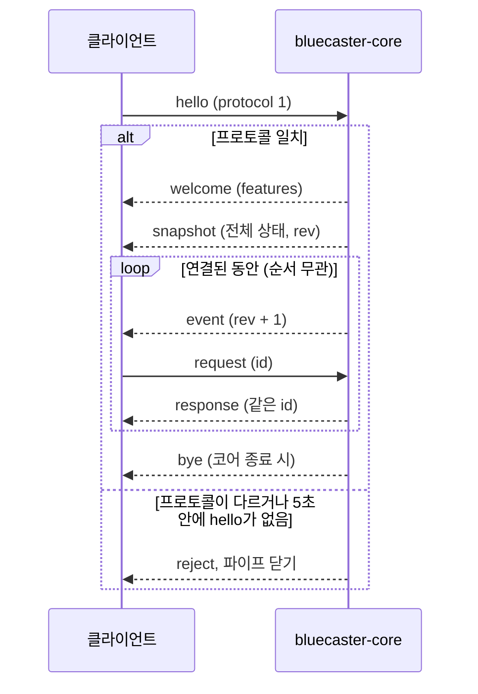

# 연동 (IPC)
{: .no_toc }

타사 도구가 BlueCaster 코어와 통신하는 방법입니다. 스트림 상태를 표시하고, 프로필을 시작·중지하고, 볼륨을 설정하거나, BlueCaster의 Bluetooth 링크를 통해 헤드폰 자체의 서비스에 접근할 수 있습니다. 이런 기능을 쓰는 도구는 [함께 쓰는 도구](works-with)에 정리되어 있습니다.

{: .warning }
> 2.0.2 베타 기간에는 프로토콜이 아직 바뀔 수 있습니다. 정확한 정의는 [`app/src/crates/ipc/src/protocol.rs`](https://github.com/SeiyaFunaokaJP/BlueCaster/blob/main/app/src/crates/ipc/src/protocol.rs)와, 여기서 생성한 [`app/src/ui/src/ipc/bindings`](https://github.com/SeiyaFunaokaJP/BlueCaster/tree/main/app/src/ui/src/ipc/bindings)의 TypeScript 타입을 기준으로 합니다. 이 페이지는 사용법을 설명할 뿐, 모든 필드를 나열하지는 않습니다.

## 목차
{: .no_toc .text-delta }

1. TOC
{:toc}

## 연결 {#connecting}

코어(`bluecaster-core.exe`)는 BlueCaster가 실행 중이면 창이 열려 있든 없든 항상 실행됩니다. 코어는 실행한 사용자 전용 named pipe에서 연결을 기다립니다.

```
\\.\pipe\bluecaster-<user SID>
```

- `<user SID>`는 로그온한 사용자의 SID 문자열(`S-1-5-21-...`)이며, `whoami /user` 등으로 확인할 수 있습니다. 사용자마다 코어와 파이프가 따로 있습니다. 파이프의 DACL은 해당 사용자만 허용하며, 원격 클라이언트는 거부합니다.
- 파이프는 바이트 모드입니다. 여러 클라이언트가 동시에 연결할 수 있으며(BlueCaster 창도 그중 하나), 모든 클라이언트가 같은 상태와 이벤트를 받습니다.
- 2.0.x까지는 파이프 이름이 `\\.\pipe\a2dpwb-<user SID>`였습니다. BlueCaster 3.0.0은 **두** 이름을 모두 제공하며, 이전 이름은 3.0.0 이후 최소 6개월 동안 계속 제공합니다. 클라이언트는 먼저 `bluecaster-<user SID>`에 연결해 보고, 실패하면 이전 이름으로 연결하세요. 프로토콜 버전은 1 그대로입니다.
- 코어가 실행 중인지 확인하려면 코어의 뮤텍스가 아니라 파이프를 보세요. 파이프가 없으면 코어가 실행되지 않은 것입니다.
- `BLUECASTER_INSTANCE=<name>`으로 시작한 개발 빌드는 대신 `\\.\pipe\bluecaster-<SID>-<name>`에서 대기하므로, 설치된 버전과 나란히 실행할 수 있습니다.

### 프레임 {#frames}

메시지는 방향과 관계없이 모두 프레임 하나로 보냅니다. 프레임은 JSON 길이(**u32 little-endian**) 뒤에 JSON(UTF-8)이 이어지는 형식입니다. 4 MiB를 넘는 프레임은 거부됩니다.

### 핸드셰이크 {#handshake}

1. 클라이언트는 연결 후 5초 안에 `hello`를 보냅니다.
   ```json
   {"type": "hello", "protocol": 1, "client": "mytool/1.2.0"}
   ```
   `client`에는 원하는 이름과 버전을 넣으면 되며, 코어의 로그에 표시됩니다.
2. 코어는 `welcome`으로 응답하거나, `reject`로 응답하고 파이프를 닫습니다(프로토콜 버전이 다르거나 hello가 없을 때).
   ```json
   {"type": "welcome", "protocol": 1, "server": "bluecaster-core/2.0.2-beta.12", "features": ["rfcomm"]}
   {"type": "reject", "reason": "protocol 2 not supported (core speaks 1)"}
   ```
3. 코어가 전체 상태를 담은 `snapshot`을 보내고, 이후 `event`를 보냅니다.

프로토콜 버전은 정확히 일치해야 합니다. 하위 호환되는 추가 기능은 버전 대신 `features`로 알립니다([호환성](#compatibility) 참고).



## 상태와 이벤트 {#state-and-events}

```json
{"type": "snapshot", "rev": 41, "state": {"adapter": {...}, "devices": [...], "stream": {...}, "profiles": [...], "active_profile": "WH-1000XM5", "settings": {...}, ...}}
{"type": "event", "rev": 42, "event": {"kind": "stream", "value": {"state": "streaming", "profile": "WH-1000XM5", "info": {"codec": "ldac", "bitrate_kbps": 990, ...}, "volume": 80, ...}}}
```

클라이언트가 상태를 따로 관리할 필요는 없습니다. 마지막 스냅샷을 보관하고 이벤트가 올 때마다 적용하면 됩니다. 상태 이벤트 하나는 스냅샷의 **한 부분 전체를 대체**합니다.

| 이벤트 `kind` | 대체하는 부분 |
|:--|:--|
| `adapter` | `adapter` |
| `devices` | `devices` |
| `scanning`, `le_scanning` | `scanning`, `le_scanning` |
| `stream` | `stream` (상태, 메시지, 프로필, 코덱 정보, 볼륨, 배터리) |
| `profiles` | `profiles`와 `active_profile` |
| `settings` | `settings` |
| `update` | `update` |
| `capture` | `capture` |
| `v1_running`, `verbose`, `crashes` | 같은 이름의 필드 |

`stream.state`는 `idle`, `connecting`, `streaming`, `reconnecting`, `error` 중 하나입니다. 그 이유는 `stream.message`에 [메시지 키](#errors-and-messages)로 들어 있습니다.

**리비전.** 상태 이벤트에는 항상 다음 리비전(`rev` + 1)이 붙습니다. 번호가 건너뛰었다면 이벤트를 놓친 것이므로 `state.snapshot`을 보내 새 스냅샷을 받으세요. 클라이언트가 너무 느리게 읽으면 코어가 요청 없이도 새 `snapshot`을 보냅니다. 상태 이벤트가 아닌 이벤트(`link`, `log`, `receiver`, `rfcomm_data`, `rfcomm_closed`)에는 현재 리비전이 붙으며, 리비전을 올리지 않습니다.

코어는 종료할 때 `bye` 이벤트를 보내고 파이프를 닫습니다.

## 요청 {#requests}

```json
{"type": "request", "id": 7, "method": "stream.start", "params": {"profile": "WH-1000XM5"}}
{"type": "response", "id": 7, "result": null, "error": null}
```

- `id`는 클라이언트가 정하는 임의의 숫자이며, 응답에 그대로 담겨 돌아옵니다. 요청은 동시에 처리되므로 응답 순서가 요청 순서와 다를 수 있습니다.
- 매개변수가 없는 메서드에서는 `params`를 생략합니다.
- 상태를 바꾸는 요청은 변경이 끝난 뒤에 응답이 오고, 같은 변경이 이벤트로도 전달됩니다. 상태는 응답이 아니라 이벤트를 보고 표시하세요.

### 오류와 메시지 {#errors-and-messages}

```json
{"type": "response", "id": 8, "result": null, "error": {"code": "rfcomm.not_connected", "message": {"key": "ipc.error.rfcomm_not_connected", "args": []}}}
```

`code`는 프로그램에서 판별하는 용도입니다(`adapter.driver_missing`, `app.streaming`, ...). `message`는 상태에 들어 있는 상태 텍스트와 마찬가지로 BlueCaster 언어 파일([`app/lang`](https://github.com/SeiyaFunaokaJP/BlueCaster/tree/main/app/lang))의 번역 키와 printf 형식 인수로 되어 있습니다. 도구는 언어 파일에서 키를 찾아 쓰거나, 코드별로 자체 텍스트를 표시하면 됩니다.

### 메서드 {#methods}

도구용 메서드:

| 메서드 | 매개변수 | 결과 |
|:--|:--|:--|
| `state.snapshot` | -- | `Snapshot` |
| `stream.start` | `profile` | `null`. 실행 중인 스트림이 있으면 먼저 중지 |
| `stream.stop` | -- | `null` |
| `stream.set_volume` | `volume` (AVRCP 절대 볼륨 0-127) | `null` |
| `profile.set_active` | `name` | `null` |
| `device.scan` | `seconds` (3-600) | `Device[]`, `devices` 이벤트로도 전달 |
| `device.scan_stop` | -- | `null`. 실행 중이던 `device.scan`이 이때 결과를 반환 |
| `audio.devices` | -- | `AudioDevice[]` (캡처 소스) |
| `diag.subscribe` | `logs` (수준 또는 `null`), `link` (bool), `receiver` (bool, 선택) | `null`. 이 연결에 대한 `log` / `link` / `receiver` 이벤트 전송을 시작하거나 중지 |
| `diag.info` | `{"mask": bool}` (선택) | `DiagInfo` ("진단 정보 복사"의 텍스트) |
| `rfcomm.open`, `rfcomm.send`, `rfcomm.close` | [RFCOMM 패스스루](#rfcomm-passthrough) 참고 | |

BlueCaster 창이 쓰는 메서드 중 도구에서는 주의해서 써야 하는 것: `profile.save` / `profile.delete`, `settings.set`(설정을 **모두** 대체합니다. 일부만 담은 객체는 절대 보내지 말고, 최신 `settings`에 변경 사항을 반영해 보내세요), `device.forget` / `device.rename`, `adapter.*`(`adapter.assign_winusb`와 `adapter.restore_driver`는 UAC 프롬프트를 표시하고, 개발자 모드의 칩 도구인 `adapter.probe`와 `adapter.run_script`는 Bluetooth 스택을 중지합니다), `app.quit`. 나머지 메서드(`stream.start_custom`, 그 밖의 `device.*`(`device.import_windows_pairings`는 UAC 프롬프트를 표시), `audio.apps`, `audio.mixer` / `audio.mixer_set`, 위 두 가지 외의 `diag.*`, `receiver.*`, `app.*`)는 창의 화면 전용이며 예고 없이 바뀔 수 있습니다. 매개변수와 결과를 포함한 전체 목록은 `protocol.rs`의 `Method` enum에 있습니다.

## RFCOMM 패스스루 {#rfcomm-passthrough}

`welcome.features`에 `"rfcomm"`이 있을 때 사용할 수 있습니다(2.0.2-beta.10 이상). 도구가 BlueCaster의 기존 연결을 통해 헤드폰 자체의 RFCOMM 서비스(제조사 제어 앱의 배터리, 노이즈 컨트롤, EQ 등)에 접근할 수 있습니다. BlueCaster로 연결된 헤드폰은 Windows에서 보이지 않기 때문입니다.

- `rfcomm.open {address, uuid}` → `{channel_id, mtu}`. `address`는 현재 스트리밍 중인 장치여야 합니다. 코어는 이 요청 때문에 새로 연결하거나 페어링하지 않습니다(`rfcomm.not_connected`). `uuid`는 128비트 전체 UUID이거나, Bluetooth 기본 UUID 기반의 16비트 `"xxxx"`입니다. 다른 open 요청 뒤에 대기하더라도 응답은 20초 안에 오므로, 최소 25초는 기다리세요. 오류: `rfcomm.not_connected`, `rfcomm.service_not_found`, `rfcomm.open_failed`, `rfcomm.busy`.
- `rfcomm.send {channel_id, data}` → `null`. `data`는 base64(표준, 패딩 있음)로, 요청당 최대 64 KiB입니다. 요청 순서대로 최대 `mtu` 크기의 프레임으로 나뉘어 전송됩니다. 오류: `rfcomm.no_channel`, `rfcomm.busy`(대기열이 가득 차 전송하지 않음), `rfcomm.timeout`(전송 여부를 알 수 없음: 다시 보내지 말고 채널을 다시 여세요).
- 수신한 데이터는 채널을 연 연결에만 `rfcomm_data` 이벤트 `{channel_id, data}`로 도착합니다.
- `rfcomm.close {channel_id}` → `null`. 앞서 보낸 데이터가 모두 전송된 뒤에 응답하며, `rfcomm_closed`는 따로 오지 않습니다.
- 파이프 연결이 끝나도 채널이 닫힙니다. 다음 경우에는 `rfcomm_closed` 이벤트 `{channel_id, reason}`과 함께 닫힙니다: `remote`(장치가 닫았거나 링크가 끊김), `disconnected`(A2DP 연결이 끝남), `stopped`(Bluetooth 스택이 중지됨), `overflow`(클라이언트가 읽지 않은 수신 데이터가 1 MiB를 넘음).

## 호환성 {#compatibility}

- **기능.** 추가 기능을 쓰기 전에 `welcome.features`를 확인하세요. 2.0.2-beta.10 이전의 코어에는 이 필드가 없습니다.
- **알 수 없는 요청.** 코어가 해석할 수 없는 요청(알 수 없는 메서드, 잘못된 매개변수)에는 `ipc.bad_request` 오류로 응답하고, 연결은 유지합니다. 2.0.2-beta.10 이전의 코어는 이 경우 연결을 닫습니다. 그 밖에 해석할 수 없는 프레임을 받으면 연결을 닫습니다.
- **새 필드.** 코어는 앞으로도 상태와 이벤트에 필드를 추가합니다. 모르는 필드는 무시하고, 그 때문에 메시지를 거부하지 마세요.
- **3.0.0의 이름 변경**([#193](https://github.com/SeiyaFunaokaJP/BlueCaster/issues/193)): 파이프 이름이 `\\.\pipe\bluecaster-<SID>`로 바뀝니다. 코어는 3.0.0 이후 최소 6개월 동안 같은 프로토콜로 `\\.\pipe\a2dpwb-<SID>`에서도 계속 대기합니다. 이 이름을 없앨 때는 먼저 릴리스 노트로 알립니다. 먼저 `bluecaster-<SID>`에 연결해 보고, 실패하면 `a2dpwb-<SID>`로 연결하세요. 코어의 뮤텍스 이름은 `Local\BlueCaster_Core`로 바뀌지만, 같은 기간 동안 `Local\A2DPWB_v2_Core`도 계속 유지합니다. 두 이전 이름의 제거는 함께 공지합니다.

## 예제 {#example}

스트림 상태를 출력하고 변화를 계속 따라가는 최소한의 Python 클라이언트입니다(표준 라이브러리만 사용).

```python
import json, struct, subprocess

sid = subprocess.run(["whoami", "/user", "/fo", "csv", "/nh"],
                     capture_output=True, text=True).stdout.strip().split(",")[1].strip('"')
pipe = open(rf"\\.\pipe\bluecaster-{sid}", "r+b", buffering=0)

def send(msg):
    b = json.dumps(msg).encode()
    pipe.write(struct.pack("<I", len(b)) + b)

def read_exact(n):
    buf = b""
    while len(buf) < n:
        chunk = pipe.read(n - len(buf))
        if not chunk:
            raise EOFError
        buf += chunk
    return buf

def recv():
    (n,) = struct.unpack("<I", read_exact(4))
    return json.loads(read_exact(n))

send({"type": "hello", "protocol": 1, "client": "example/0.1"})
welcome = recv()
assert welcome["type"] == "welcome", welcome
snap = recv()
print("stream:", snap["state"]["stream"]["state"])
while True:
    m = recv()
    if m["type"] == "event" and m["event"]["kind"] == "stream":
        s = m["event"]["value"]
        print("stream:", s["state"], (s.get("info") or {}).get("codec"))
    elif m["type"] == "event" and m["event"]["kind"] == "bye":
        break
```

설치된 BlueCaster에 영향을 주지 않고 도구를 시험하려면, `BLUECASTER_INSTANCE`와 `BLUECASTER_CONFIG_DIR`을 설정해 개발 빌드를 실행하고([빌드](building) 참고) 그 파이프에 연결하세요.
