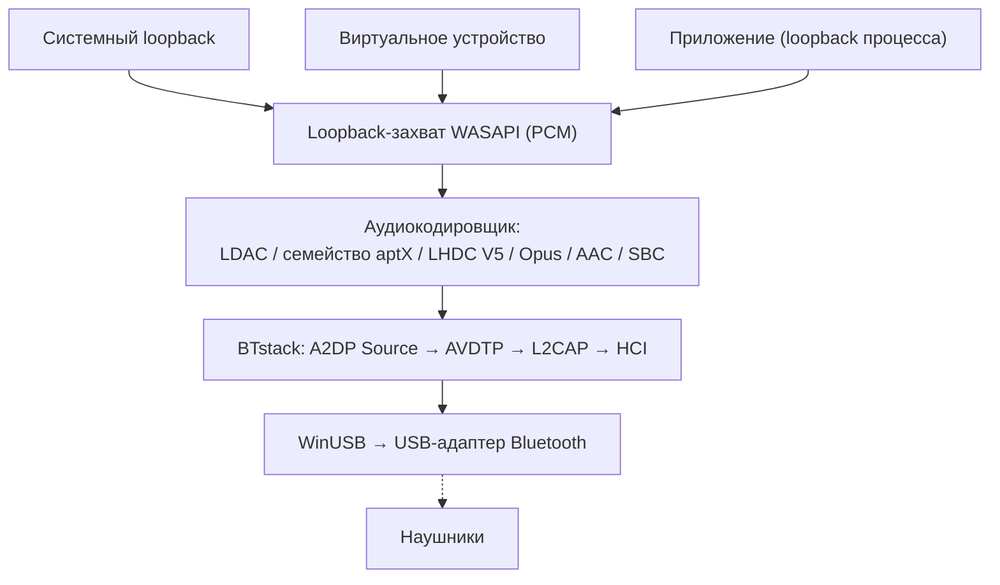

# BlueCaster

Продвинутый Bluetooth-аудиопередатчик для Windows с полной поддержкой кодеков.
{: .fs-6 .fw-300 }

BlueCaster превращает ваш адаптер Bluetooth в Hi-Fi-аудиопередатчик. Он передаёт звук на наушники через Hi-Fi-кодеки, такие как **LDAC@96 kHz**, **LHDC V5@192 kHz** и **aptX Adaptive**. Сама Windows ни один из этих кодеков не поддерживает. Также BlueCaster поддерживает aptX HD, aptX, aptX Low Latency, Opus, AAC, SBC XQ, SBC и FastStream.

- **Работает с Bluetooth, который у вас уже есть.** Подойдёт встроенный Bluetooth Intel, Realtek или MediaTek во многих ноутбуках, а также недорогой USB-адаптер. BlueCaster берёт адаптер на себя, а вернуть его Windows можно одним щелчком.
- **Микрофон гарнитуры, который не мешает.** Микрофон включается, только пока приложение ведёт запись. В остальное время музыка звучит в полном качестве. Шумоподавление и регулировка усиления встроены.
- **Без дополнительных программ.** BlueCaster настраивает адаптер прямо в приложении ([как это работает](architecture)).

[Начало работы](setup){: .btn .btn-primary .fs-5 .mb-4 .mb-md-0 .mr-2 }
[GitHub](https://github.com/SeiyaFunaokaJP/BlueCaster){: .btn .fs-5 .mb-4 .mb-md-0 }

---

## Поддерживаемые кодеки

| Кодек | Битрейт | Частота дискретизации | Разрядность | Задержка |
|:------|:--------|:----------------------|:------------|:---------|
| LHDC V5 | 400/500/900/1000 kbps, ABR 160--400 kbps | 44,1/48/96/192 kHz | 16/24 бит | — |
| LDAC | 330/660/990 kbps | 44,1--96 kHz | 16/24/32 бит | ~200 ms |
| aptX Adaptive | 265/427 kbps (96 kHz: 646) | 48/96 kHz | 24 бит | — |
| Opus | 256 kbps | 48 kHz | 16 бит | — |
| aptX HD | 576 kbps | 44,1/48 kHz | 24 бит | ~150 ms |
| aptX | 352/384 kbps | 44,1/48 kHz | 16 бит | — |
| aptX Low Latency | 352 kbps | 44,1/48 kHz | 16 бит | ~32 ms |
| AAC | до 256 kbps | 44,1/48 kHz | 16 бит | ~150 ms |
| SBC XQ | ~385/505/552 kbps | 44,1/48 kHz | 16 бит | ~150 ms |
| SBC | до ~345 kbps | 44,1/48 kHz | 16 бит | ~150 ms |
| FastStream | 198/216 kbps | 44,1/48 kHz | 16 бит | — |
| Opus 05 | 256 kbps | 48 kHz | 16 бит | — |
| LC3 (LE Audio) 🧪 | 32--124 kbps на канал | 16/24/32/48 kHz | 16 бит | ~140 ms |
| LC3 LL (LE Audio GMAP) 🧪 | 64--96 kbps на канал | 32/48 kHz | 16 бит | ~30 ms |

### Поддержка кодеков по платформам (передача на наушники)

| Кодек | Встроенная в Windows 10 | Встроенная в Windows 11 | Встроенная в Ubuntu (PipeWire) | **BlueCaster** (Windows 10 / 11) |
|:------|:-----------------------:|:-----------------------:|:------------------------------:|:----------------------------:|
| LHDC V5 | ❌ | ❌ | ❌ | ✅ |
| LDAC | ❌ | ❌ | ✅ | ✅ |
| aptX Adaptive | ❌ | ❌ | ❌ | ✅ |
| Opus (A2DP Opus из Android) | ❌ | ❌ | ✅ PipeWire 1.2+ (`opus_g`); нет в Ubuntu 24.04 (PipeWire 1.0.5) | ✅ |
| aptX HD | ❌ | ❌ | ✅ | ✅ |
| aptX | ✅ | ✅ | ✅ | ✅ |
| aptX Low Latency | ❌ | ❌ | ✅ | ✅ |
| AAC | ❌ | ✅ | ❌ нет в пакетах Ubuntu | ✅ |
| SBC XQ | ❌ | ❌ | ✅ | ✅ (приёмники, чей SBC допускает dual channel, bitpool ≥ 29) |
| SBC | ✅ | ✅ | ✅ | ✅ |
| FastStream | ❌ | ❌ | ✅ | ✅ (только музыка, только при явном выборе) |
| Opus 05 (собственный Opus PipeWire) | ❌ | ❌ | ✅ PipeWire 0.3.57+ (`opus_05`, только на устройства с PipeWire) | ✅ (только при явном выборе, только в режиме разработчика) |
| LC3 (LE Audio, BAP unicast) | ❌ | ✅ на ПК, чьё оборудование и драйвер Bluetooth поддерживают LE Audio | ✅ PipeWire BAP `lc3` (LE Audio в BlueZ) | 🧪 экспериментально, только в режиме разработчика (запись LE Audio устройства; GMAP с низкой задержкой на игровых гарнитурах; адаптер Bluetooth 5.2 с ISO, [Использование](usage#le-audio)) |

✅ поддерживается · 🧪 экспериментально · ❌ не поддерживается. Все столбцы относятся к передающей стороне (ПК → наушники). «Встроенная» означает собственную поддержку Bluetooth-звука в ОС без BlueCaster. В столбце Ubuntu указан набор кодеков PipeWire в Ubuntu 26.04 (`libspa-0.2-bluetooth`).

{: .warning }
**aptX HD и aptX Low Latency** реализованы по образцу Android / PipeWire и проходят тесты кодирования и обратного декодирования, но на реальных наушниках ещё не проверены. Задержки в таблице — типичные значения, а не измерения с BlueCaster.

{: .warning }
**О LHDC V5.** BlueCaster использует перенесённый на C кодировщик LHDC V5, который Google добавила в Android 17 (AOSP, Apache-2.0). Его вывод побитово совпадает с выводом кодировщика AOSP на Rust, а сигнализация A2DP повторяет `a2dp_vendor_lhdcv5` из Android. Пользователь подтвердил работу LHDC V5 на реальных наушниках при 1000 kbps / 192 kHz в v1.1.1-beta.1 ([#50](https://github.com/SeiyaFunaokaJP/BlueCaster/issues/50)); v2 использует тот же кодировщик. Поддерживается только LHDC V5 с потерями: для LHDC V2/V3 (старые наушники) и режима без потерь «LHDC-RAW» нет кодировщика с открытым исходным кодом. В режиме «Авто» LHDC V5 стоит первым, выше LDAC.

{: .warning }
**Opus** — вендорный кодек A2DP Opus из Android (Android 13+, vendor ID 0x000000E0 Google): 48 kHz, кадры по 20 ms, 256 kbps стерео, как запрашивает Android (Standard 192, Mobile 128 kbps). Кодирует libopus 1.6.1. Кодек проходит сквозной тест с виртуальным приёмником, но на реальных наушниках с Opus ещё не проверен. В режиме «Авто» он стоит ниже aptX Adaptive и выше aptX HD.

{: .warning }
**Opus 05** — собственный вендорный кодек A2DP Opus проекта PipeWire (vendor ID 0x000005F1, codec 0x1005; PipeWire `opus_05`). Его реализует только PipeWire, поэтому приёмником должен быть ПК с PipeWire в роли приёмника A2DP. BlueCaster передаёт только стереомузыку (без 5.1 / 7.1 и без обратного канала): 48 kHz, кадры по 10 ms (или 20 ms, если приёмник поддерживает только их). Кодировщик libopus и битрейты те же, что у Opus, но не выше предела приёмника. «Авто» никогда не выбирает этот кодек: выберите его на экране **Кодеки** или с помощью `-c opus05`. Кодек проходит сквозной тест с виртуальным приёмником, который предлагает возможности PipeWire, но с реальным приёмником PipeWire не проверялся. В роли приёмника A2DP PipeWire декодирует Opus 05 начиная с 0.3.57, а Opus из Android (`opus_g`) — начиная с 1.2.0. В Ubuntu 24.04 LTS входит PipeWire 1.0.5 (только Opus 05), в Ubuntu 25.10 (1.4.7) и 26.04 LTS (1.6.2) — оба кодека. Ни один из них пока не проверен с BlueCaster.

{: .warning }
**SBC XQ** проверен на Sony WH-1000XM4 (dual channel, bitpool 43 при 48 kHz, 552 kbps). Если приёмник отклоняет такую конфигурацию, BlueCaster переподключается с обычным SBC. **FastStream** проходит сквозной тест с виртуальным приёмником, но на реальных наушниках с FastStream не проверялся. Он передаёт только музыку, и «Авто» никогда его не выбирает.

{: .note }
**Нужен только классический aptX?** Windows 10 уже поддерживает классический aptX во встроенном стеке Bluetooth (но не aptX HD, aptX LL или aptX Adaptive), поэтому BlueCaster для него не нужен. BlueCaster полезен прежде всего для LHDC V5, LDAC, aptX Adaptive, aptX HD и aptX Low Latency.

{: .note }
**Об aptX Adaptive.** BlueCaster кодирует его кодировщиком на чистом Rust под лицензией MIT из [AKS-Logic/aptx-adaptive-linux](https://github.com/AKS-Logic/aptx-adaptive-linux). Его авторы восстановили таблицы кодировщика по двоичным файлам Qualcomm и записям эфира. 48 kHz стерео (при запросе 44,1 kHz звук захватывается с частотой 48 kHz), 24 бит: «Высокое» 427 kbps или «Низкая задержка» 265 kbps (приёмники R2: 270), ABR в режиме «Высокое». 96 kHz («Высокое», 646 kbps) используется, если вы выбрали эту частоту в настройках кодека, а наушники — приёмник R2 с поддержкой 96 kHz. В режиме «Низкая задержка» 96 kHz не используется, а «Авто» передаёт 48 kHz. «Авто» ставит aptX Adaptive после LHDC V5 и LDAC; его также можно выбрать на экране **Кодеки** или с помощью `-c aptxad`. Пользователь подтвердил работу на EarFun Air Pro 4+ при 48 kHz в 2.0.2-beta.6 (так же стабильно, как классический aptX), а позже и 96 kHz на реальных наушниках ([#86](https://github.com/SeiyaFunaokaJP/BlueCaster/issues/86)). Авторы кодировщика сообщают о работе в Linux с Bose QuietComfort Ultra (1-го поколения) и B&W Px7 S2e. См. [Семейство aptX и aptX Adaptive](usage#aptx-compatibility).

## Поддержка платформ {#platform-support}

| Компонент | Windows 10 (x64 / ARM64) | Windows 11 (x64 / ARM64) | Linux (Ubuntu) |
|:----------|:----------------:|:----------------:|:--------------:|
| **BlueCaster** (окно, область уведомлений, CLI) | ✅ (ещё не проверялся на реальном оборудовании) | ✅ | ❌ |
| [Сборка из исходного кода](building) (Rust, Visual Studio 2022+) | ✅ | ✅ | ❌ |
| `bluecaster_decode` (проверка потока) | ✅ | ✅ | ❌ |
| Сквозной тест `tools/emu/run_test.py` | ✅ | ✅ | ❌ |
| Виртуальный адаптер `tools/emu/emu_vhci.py` | ❌ | ❌ | ✅ |
| [Измерительный приёмник](usage#receiver) `tools/linux_sink` | ❌ | ❌ | ✅ |

Сам BlueCaster работает только в Windows (Windows 10 или Windows 11) и собирается для x64 и ARM64. Инструментам для Linux нужен Python 3.11 или новее (проверено в Ubuntu 26.04). `setup.sh` рассчитан на Ubuntu / Debian, в других дистрибутивах пакеты нужно установить вручную.

## Проверенное оборудование {#verified-hardware}

Проверено с Sony WH-1000XM4 и WH-1000XM6, EarFun Air Pro 4+, Grado GW100x и другими наушниками на адаптерах TP-Link UB500, безымянном RTL8761B, встроенном в ноутбук RTL8852BE, ASUS BT400 и CSR8510. Полный список с кодеками, версиями и ссылками на отчёты — на странице **[Проверенное оборудование](hardware)**.

## Выпадения звука и проблемы с подключением

На странице **[Выпадения звука и проблемы с подключением](wireless)** описано, чем оказывались прошлые сообщения о таких проблемах, что проверить перед отправкой отчёта и как читать «Качество связи».

## Совместимые инструменты

На странице **[Совместимые инструменты](works-with)** перечислены сторонние приложения, например для управления наушниками, которые по сообщениям пользователей работают с BlueCaster. BlueCaster их не разрабатывает и не поддерживает.

## Режимы захвата звука

BlueCaster захватывает звук через WASAPI и предлагает три режима:

| Режим | Описание | Применение |
|:------|:---------|:-----------|
| **Устройство по умолчанию** | Захватывает весь системный звук с устройства воспроизведения по умолчанию | Простая настройка — передаются все звуки |
| **Виртуальное устройство** | Захватывает звук с выбранного виртуального аудиоустройства (например, VB-CABLE, VoiceMeeter) | Отправить отдельные приложения на Bluetooth, а остальной звук оставить на динамиках |
| **Приложение** | Захватывает только то, что воспроизводит одно приложение, после его собственной обработки (Windows 11 / Windows 10 2004+) | Передать звук одного приложения или вывод общесистемного приложения эффектов (эквалайзер, улучшитель звука) |

В режиме **Виртуальное устройство** BlueCaster может сделать выбранное виртуальное устройство устройством воспроизведения по умолчанию в Windows (**Делать устройством вывода по умолчанию на время подключения**), а затем захватывает его выход через loopback. Всё, что приложения воспроизводят на виртуальном устройстве, передаётся по Bluetooth. Когда передача прекращается, BlueCaster возвращает прежнее устройство по умолчанию.

Источник **Устройство по умолчанию** не отбирает звук у устройства воспроизведения по умолчанию: звук играет и там, и через Bluetooth. Если выбранное виртуальное устройство не удаётся открыть, BlueCaster передаёт вместо него системный звук и сообщает об этом. См. [Режимы захвата](usage#capture-modes).

## Как это работает

BlueCaster полностью обходит стек Bluetooth Windows. Он работает с USB-адаптером Bluetooth напрямую через WinUSB, а весь стек протоколов Bluetooth реализует в пользовательском режиме с помощью [BTstack](https://github.com/bluekitchen/btstack). Звук передаёт небольшая фоновая программа (`bluecaster-core.exe`, со значком в области уведомлений). Окно только показывает её состояние, поэтому закрытие окна не останавливает звук (см. [Архитектура](architecture)).

## Возможности

- **Много кодеков**: LHDC V5, LDAC, aptX Adaptive, aptX, AAC, aptX HD, aptX Low Latency, Opus, Opus 05, FastStream, SBC XQ и SBC с автоматическим согласованием
- **LE Audio (экспериментально, только в режиме разработчика)**: LC3 на наушники LE Audio (BAP unicast, оба наушника пары, громкость гарнитуры, кнопки управления воспроизведением, GMAP с низкой задержкой). Нужен адаптер с изохронными каналами Bluetooth 5.2. LE Audio пока работает ненадёжно на реальных адаптерах, включая MediaTek MT7925 ([Использование](usage#le-audio))
- **Три режима захвата**: системный loopback, маршрутизация через виртуальное аудиоустройство или вывод одного приложения
- **Окно, область уведомлений и CLI**: окно для настройки и диагностики, мини-окно и меню в области уведомлений для повседневного подключения и командная строка (см. [Использование](usage))
- **WinUSB прямо в приложении**: назначает адаптеру драйвер WinUSB и восстанавливает исходный драйвер без Zadig (см. [Настройка](setup#winusb)). Наушники, сопряжённые в Windows через этот адаптер, подключаются без повторного сопряжения
- **Настройка при первом запуске**: адаптер, драйвер и прошивка, наушники, первое подключение, общие настройки
- **ABR**: адаптивный битрейт для нестабильных соединений (LDAC, LHDC V5 и aptX Adaptive; адаптивный bitpool для SBC и SBC XQ)
- **Автоматическое переподключение**: после потери связи (3 попытки; 10, если адаптер нужно запустить заново) и после выхода ПК из спящего режима. Отключается параметром **Переподключаться автоматически** на экране **Аудиоустройства**
- **Качество связи и AFH**: показывает, что передаётся, RSSI и используемые каналы, и сообщает адаптеру, какие каналы Wi-Fi обходить (см. [Использование](usage#link-quality))
- **Управление с наушников (AVRCP)**: ползунок громкости синхронизирован с наушниками и громкостью Windows. Кнопки наушников (воспроизведение/пауза, следующий и предыдущий трек) управляют воспроизведением на ПК (см. [Использование](usage#headphone-buttons))
- **Настройки для каждого устройства**: у каждого аудиоустройства свой кодек (со своими настройками) и источник звука. Устройства показаны рядом на экране «Главная», подключать их можно из области уведомлений
- **Обновления**: установленная версия обновляется автоматически, когда аудиоустройство отключится (см. [Использование](usage#updates))
- **Локализация**: английский, японский, китайский (упрощённый / традиционный), корейский, немецкий, французский, испанский, украинский и русский
- **Прошивка Realtek**: пошаговое скачивание прошивки для адаптеров Realtek
- **Диагностика**: ход подключения, журнал, запись HCI, сведения для отчётов об ошибках, тест с приёмником на ПК с Linux (см. [Использование](usage#receiver))
