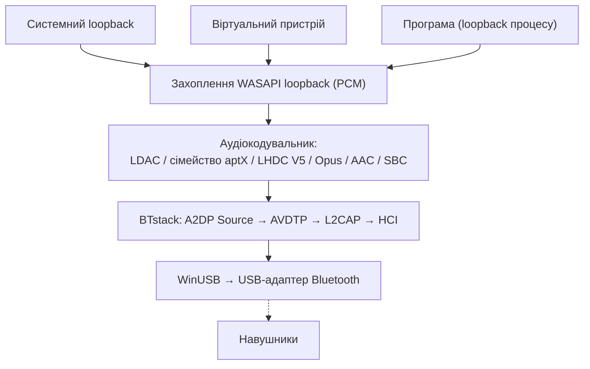

# BlueCaster

Розширений Bluetooth-аудіопередавач для Windows з повною підтримкою кодеків.
{: .fs-6 .fw-300 }

BlueCaster перетворює ваш адаптер Bluetooth на Hi-Fi-аудіопередавач. Він передає звук на навушники через Hi-Fi-кодеки, як-от **LDAC@96 kHz**, **LHDC V5@192 kHz** і **aptX Adaptive**. Сама Windows жодного з цих кодеків не підтримує. Також BlueCaster підтримує aptX HD, aptX, aptX Low Latency, Opus, AAC, SBC XQ, SBC і FastStream.

- **Працює з Bluetooth, який у вас уже є.** Підійде вбудований Bluetooth Intel, Realtek або MediaTek у багатьох ноутбуках, а також недорогий USB-донгл. BlueCaster бере адаптер на себе, а повернути його Windows можна одним клацанням.
- **Мікрофон гарнітури, який не заважає.** Мікрофон вмикається, лише поки застосунок записує. Решту часу музика звучить у повній якості. Шумозаглушення й регулювання підсилення вбудовані.
- **Без додаткових програм.** BlueCaster налаштовує адаптер безпосередньо в застосунку ([як це працює](architecture)).

[Початок роботи](setup){: .btn .btn-primary .fs-5 .mb-4 .mb-md-0 .mr-2 }
[GitHub](https://github.com/SeiyaFunaokaJP/BlueCaster){: .btn .fs-5 .mb-4 .mb-md-0 }

---

## Підтримувані кодеки

| Кодек | Бітрейт | Частота дискретизації | Розрядність | Затримка |
|:------|:--------|:----------------------|:------------|:---------|
| LHDC V5 | 400/500/900/1000 kbps, ABR 160--400 kbps | 44,1/48/96/192 kHz | 16/24 біт | -- |
| LDAC | 330/660/990 kbps | 44,1--96 kHz | 16/24/32 біт | ~200 ms |
| aptX Adaptive | 265/427 kbps (96 kHz: 646) | 48/96 kHz | 24 біт | -- |
| Opus | 256 kbps | 48 kHz | 16 біт | -- |
| aptX HD | 576 kbps | 44,1/48 kHz | 24 біт | ~150 ms |
| aptX | 352/384 kbps | 44,1/48 kHz | 16 біт | -- |
| aptX Low Latency | 352 kbps | 44,1/48 kHz | 16 біт | ~32 ms |
| AAC | до 256 kbps | 44,1/48 kHz | 16 біт | ~150 ms |
| SBC XQ | ~385/505/552 kbps | 44,1/48 kHz | 16 біт | ~150 ms |
| SBC | до ~345 kbps | 44,1/48 kHz | 16 біт | ~150 ms |
| FastStream | 198/216 kbps | 44,1/48 kHz | 16 біт | -- |
| Opus 05 | 256 kbps | 48 kHz | 16 біт | -- |
| LC3 (LE Audio) 🧪 | 32--124 kbps на канал | 16/24/32/48 kHz | 16 біт | ~140 ms |
| LC3 LL (LE Audio GMAP) 🧪 | 64--96 kbps на канал | 32/48 kHz | 16 біт | ~30 ms |

### Підтримка кодеків за платформами (передавання на навушники)

| Кодек | Вбудовано у Windows 10 | Вбудовано у Windows 11 | Вбудовано в Ubuntu (PipeWire) | **BlueCaster** (Windows 10 / 11) |
|:------|:----------------------:|:----------------------:|:-----------------------------:|:----------------------------:|
| LHDC V5 | ❌ | ❌ | ❌ | ✅ |
| LDAC | ❌ | ❌ | ✅ | ✅ |
| aptX Adaptive | ❌ | ❌ | ❌ | ✅ |
| Opus (A2DP Opus від Android) | ❌ | ❌ | ✅ PipeWire 1.2+ (`opus_g`); немає в Ubuntu 24.04 (PipeWire 1.0.5) | ✅ |
| aptX HD | ❌ | ❌ | ✅ | ✅ |
| aptX | ✅ | ✅ | ✅ | ✅ |
| aptX Low Latency | ❌ | ❌ | ✅ | ✅ |
| AAC | ❌ | ✅ | ❌ немає в пакетах Ubuntu | ✅ |
| SBC XQ | ❌ | ❌ | ✅ | ✅ (приймачі, SBC яких дозволяє dual channel, bitpool ≥ 29) |
| SBC | ✅ | ✅ | ✅ | ✅ |
| FastStream | ❌ | ❌ | ✅ | ✅ (лише музика, лише якщо вибрано явно) |
| Opus 05 (власний Opus від PipeWire) | ❌ | ❌ | ✅ PipeWire 0.3.57+ (`opus_05`, лише на пристрої з PipeWire) | ✅ (лише якщо вибрано явно, лише в режимі розробника) |
| LC3 (LE Audio, BAP unicast) | ❌ | ✅ на ПК, обладнання й драйвер Bluetooth яких підтримують LE Audio | ✅ PipeWire BAP `lc3` (LE Audio від BlueZ) | 🧪 експериментально, лише в режимі розробника (запис LE Audio пристрою; GMAP з низькою затримкою в ігрових гарнітурах; адаптер Bluetooth 5.2 з ISO, [Використання](usage#le-audio)) |

✅ підтримується · 🧪 експериментально · ❌ не підтримується. Усі стовпці стосуються передавання (ПК → навушники). «Вбудовано» означає власне аудіо Bluetooth операційної системи, без BlueCaster; у стовпці Ubuntu -- набір кодеків PipeWire в Ubuntu 26.04 (`libspa-0.2-bluetooth`).

{: .warning }
**aptX HD і aptX Low Latency** відтворюють реалізації Android / PipeWire і проходять тести повного циклу кодування й декодування, але зі справжніми навушниками ще не перевірені. Затримки в цій таблиці -- типові значення, а не виміряні з BlueCaster.

{: .warning }
**Про LHDC V5.** BlueCaster використовує порт на C кодувальника LHDC V5, який Google додала в Android 17 (AOSP, Apache-2.0). Вихід порту побітово збігається з кодувальником на Rust з AOSP, а сигналізація A2DP відповідає `a2dp_vendor_lhdcv5` в Android. Користувач підтвердив роботу LHDC V5 зі справжніми навушниками LHDC V5 на 1000 kbps / 192 kHz у v1.1.1-beta.1 ([#50](https://github.com/SeiyaFunaokaJP/BlueCaster/issues/50)); v2 використовує той самий кодувальник. Підтримується лише LHDC V5 зі стисненням із втратами: для LHDC V2/V3 (старіші навушники) і режиму без втрат «LHDC-RAW» немає кодувальника з відкритим кодом. У режимі «Авто» LHDC V5 стоїть першим, вище за LDAC.

{: .warning }
**Opus** — це вендорний кодек A2DP Opus від Android (Android 13+, vendor ID 0x000000E0 Google): 48 kHz, кадри по 20 ms, 256 kbps стерео, як запитує Android (Standard 192, Mobile 128 kbps), кодування libopus 1.6.1. Кодек проходить наскрізний тест із віртуальним приймачем, але зі справжніми навушниками Opus ще не перевірений. У режимі «Авто» він стоїть нижче за aptX Adaptive і вище за aptX HD.

{: .warning }
**Opus 05** — власний вендорний кодек A2DP Opus від PipeWire (vendor ID 0x000005F1, codec 0x1005; PipeWire `opus_05`), який реалізує лише PipeWire. Тож приймачем має бути ПК, де PipeWire працює як A2DP-приймач. BlueCaster передає лише стереомузику (без 5.1 / 7.1, без зворотного каналу): 48 kHz, кадри по 10 ms (20 ms, якщо приймач підтримує лише їх), той самий кодувальник libopus і ті самі бітрейти, що й для Opus, але не вище за межу приймача. «Авто» ніколи його не вибирає; виберіть його на екрані **Кодеки** або параметром `-c opus05`. Кодек проходить наскрізний тест із віртуальним приймачем, що пропонує можливості PipeWire, але зі справжнім приймачем PipeWire ще не випробуваний. PipeWire як A2DP-приймач декодує Opus 05 від версії 0.3.57, а Opus від Android (`opus_g`) -- від 1.2.0. Ubuntu 24.04 LTS постачається з PipeWire 1.0.5 (лише Opus 05), а Ubuntu 25.10 (1.4.7) і 26.04 LTS (1.6.2) -- з обома. Жоден із цих кодеків ще не перевірено з BlueCaster.

{: .warning }
**SBC XQ** перевірено з Sony WH-1000XM4 (dual channel, bitpool 43 на 48 kHz, 552 kbps). Якщо приймач відхиляє цю конфігурацію, BlueCaster перепідключається зі звичайним SBC. **FastStream** проходить наскрізний тест із віртуальним приймачем, але зі справжніми навушниками FastStream не випробуваний. Він передає лише музику, і «Авто» ніколи його не вибирає.

{: .note }
**Потрібен лише класичний aptX?** Windows 10 уже підтримує класичний aptX у вбудованому стеку Bluetooth (але не aptX HD, aptX LL чи aptX Adaptive), тож для нього BlueCaster не потрібен. BlueCaster корисний насамперед для LHDC V5, LDAC, aptX Adaptive, aptX HD і aptX Low Latency.

{: .note }
**Про aptX Adaptive.** BlueCaster кодує його кодувальником на чистому Rust під ліцензією MIT із [AKS-Logic/aptx-adaptive-linux](https://github.com/AKS-Logic/aptx-adaptive-linux); автори цього проєкту відтворили таблиці кодувальника з готових двійкових файлів Qualcomm і записів з ефіру. 48 kHz стерео (запити на 44,1 kHz захоплюються з частотою 48 kHz), 24 біт: High 427 kbps або Low Latency 265 kbps (приймачі R2: 270), ABR у режимі High. 96 kHz (High, 646 kbps) використовується, якщо вибрати цю частоту в параметрах кодека, а навушники є приймачем R2 з підтримкою 96 kHz; Low Latency ніколи її не використовує, а «Авто» передає 48 kHz. «Авто» ставить aptX Adaptive після LHDC V5 і LDAC; його також можна вибрати на екрані **Кодеки** або параметром `-c aptxad`. Користувач підтвердив роботу на EarFun Air Pro 4+ на 48 kHz у 2.0.2-beta.6 (так само стабільно, як класичний aptX), а згодом і 96 kHz на справжніх навушниках ([#86](https://github.com/SeiyaFunaokaJP/BlueCaster/issues/86)); автори оригінального проєкту повідомляють, що він працює в Linux із Bose QuietComfort Ultra (1-го покоління) і B&W Px7 S2e. Див. [Сімейство aptX і aptX Adaptive](usage#aptx-compatibility).

## Підтримка платформ {#platform-support}

| Компонент | Windows 10 (x64 / ARM64) | Windows 11 (x64 / ARM64) | Linux (Ubuntu) |
|:----------|:----------------:|:----------------:|:--------------:|
| **BlueCaster** (вікно, область сповіщень, CLI) | ✅ (ще не випробувано на справжньому обладнанні) | ✅ | ❌ |
| [Збирання з вихідного коду](building) (Rust, Visual Studio 2022+) | ✅ | ✅ | ❌ |
| `bluecaster_decode` (перевірка потоку) | ✅ | ✅ | ❌ |
| Наскрізний тест `tools/emu/run_test.py` | ✅ | ✅ | ❌ |
| Віртуальний адаптер `tools/emu/emu_vhci.py` | ❌ | ❌ | ✅ |
| [Вимірювальний приймач](usage#receiver) `tools/linux_sink` | ❌ | ❌ | ✅ |

Сам BlueCaster працює лише у Windows (Windows 10 або Windows 11) і збирається для x64 та ARM64. Інструментам для Linux потрібен Python 3.11 або новіший (перевірено в Ubuntu 26.04). `setup.sh` розрахований на Ubuntu / Debian; в інших дистрибутивах пакети доведеться встановити вручну.

## Перевірене обладнання {#verified-hardware}

Перевірено з Sony WH-1000XM4 і WH-1000XM6, EarFun Air Pro 4+, Grado GW100x та іншими навушниками на адаптерах TP-Link UB500, звичайному RTL8761B, вбудованому в ноутбук RTL8852BE, ASUS BT400 і CSR8510. Повний список із кодеками, версіями та звітами, на яких ґрунтується кожен запис, наведено на сторінці **[Перевірене обладнання](hardware)**.

## Перебої та проблеми з підключенням

На сторінці **[Перебої та проблеми з підключенням](wireless)** описано, чим виявлялися звіти про перебої й проблеми з підключенням, що перевірити, перш ніж повідомляти, і як читати якість зв'язку.

## Сумісні програми

На сторінці **[Сумісні програми](works-with)** перелічено сторонні програми, наприклад для керування навушниками, які, за повідомленнями користувачів, працюють із BlueCaster. BlueCaster їх не створює і не підтримує.

## Режими захоплення звуку

BlueCaster захоплює звук через WASAPI і пропонує три режими:

| Режим | Опис | Застосування |
|:------|:-----|:-------------|
| **Пристрій за замовчуванням** | Захоплює весь системний звук із пристрою відтворення за замовчуванням | Просте налаштування -- передаються всі звуки |
| **Віртуальний пристрій** | Захоплює звук із вибраного віртуального аудіопристрою (наприклад, VB-CABLE, VoiceMeeter) | Спрямувати окремі програми на Bluetooth, а решту звуку залишити на динаміках |
| **Програма** | Захоплює лише те, що відтворює одна програма, після її власної обробки (Windows 11 / Windows 10 2004+) | Передавати звук однієї програми або вивід програми системних ефектів (еквалайзер, покращувач звуку) |

У режимі **Віртуальний пристрій** BlueCaster може зробити вибраний віртуальний пристрій пристроєм відтворення Windows за замовчуванням (**Робити пристроєм виводу Windows за замовчуванням, поки підключено**) і захоплювати його вивід через loopback. Усе, що програми відтворюють на віртуальний пристрій, передається через Bluetooth. Коли передавання припиняється, BlueCaster повертає попередній пристрій за замовчуванням.

Джерело **Пристрій за замовчуванням** не забирає звук у пристрою відтворення за замовчуванням: звук грає і там, і через Bluetooth. Якщо вибраний віртуальний пристрій не вдається відкрити, BlueCaster натомість передає системний звук і повідомляє про це. Див. [Режими захоплення](usage#capture-modes).

## Як це працює

BlueCaster повністю обходить стек Bluetooth Windows. Він працює з USB-адаптером Bluetooth напряму через WinUSB, а повний стек протоколів Bluetooth у режимі користувача реалізує [BTstack](https://github.com/bluekitchen/btstack). Звук передає невелика фонова програма (`bluecaster-core.exe`, зі значком в області сповіщень); вікно лише показує її стан, тож закриття вікна не зупиняє звук (див. [Архітектура](architecture)).

## Можливості

- **Багато кодеків**: LHDC V5, LDAC, aptX Adaptive, aptX, AAC, aptX HD, aptX Low Latency, Opus, Opus 05, FastStream, SBC XQ і SBC з автоматичним узгодженням
- **LE Audio (експериментально, лише в режимі розробника)**: LC3 на навушники й навушники-вкладиші LE Audio (BAP unicast, обидва вкладиші пари, гучність гарнітури, медіакнопки, GMAP з низькою затримкою). Потрібен адаптер з ізохронними каналами Bluetooth 5.2. LE Audio поки що працює ненадійно на справжніх адаптерах, зокрема на MediaTek MT7925 ([Використання](usage#le-audio))
- **Три режими захоплення**: системний звук (loopback), спрямування через віртуальний аудіопристрій або вивід однієї програми
- **Вікно, область сповіщень і CLI**: вікно для налаштування й діагностики, панель і меню в області сповіщень для щоденного підключення та командний рядок (див. [Використання](usage))
- **WinUSB у програмі**: встановлює для адаптера драйвер WinUSB і повертає початковий драйвер, Zadig не потрібен (див. [Налаштування](setup#winusb)); навушники, які Windows сполучила через цей адаптер, підключаються без повторного сполучення
- **Налаштування під час першого запуску**: адаптер, драйвер і мікропрограма, навушники, перше підключення, загальні параметри
- **ABR**: адаптивний бітрейт для нестабільних з'єднань (LDAC, LHDC V5 і aptX Adaptive; адаптивний bitpool для SBC і SBC XQ)
- **Автоматичне повторне підключення**: перепідключається після втрати з'єднання (3 спроби; 10, якщо адаптер має запуститися знову) і після виходу ПК зі сну; вимкнути це можна параметром **Автоматично підключатися знову** на екрані **Аудіопристрої**
- **Якість зв'язку й AFH**: показує, що передається, RSSI і задіяні канали; повідомляє адаптеру, яких каналів Wi-Fi уникати (див. [Використання](usage#link-quality))
- **Керування навушниками (AVRCP)**: повзунок гучності синхронізовано з навушниками та гучністю Windows; кнопки відтворення/паузи, наступного й попереднього треку на навушниках керують відтворенням на ПК (див. [Використання](usage#headphone-buttons))
- **Параметри для кожного пристрою**: кожен аудіопристрій має власний кодек (зі своїми параметрами) і джерело звуку; усі пристрої показано поруч на екрані «Головна», і їх можна підключати з області сповіщень
- **Оновлення**: встановлена версія оновлюється автоматично, щойно аудіопристрій відключиться (див. [Використання](usage#updates))
- **Локалізація**: англійська, японська, китайська спрощена / традиційна, корейська, німецька, французька, іспанська, українська та російська
- **Мікропрограма Realtek**: покрокове завантаження мікропрограми для адаптерів Realtek
- **Діагностика**: хід підключення, журнал, захоплення HCI, діагностика для звітів про помилки, тест із приймачем-партнером на ПК з Linux (див. [Використання](usage#receiver))
