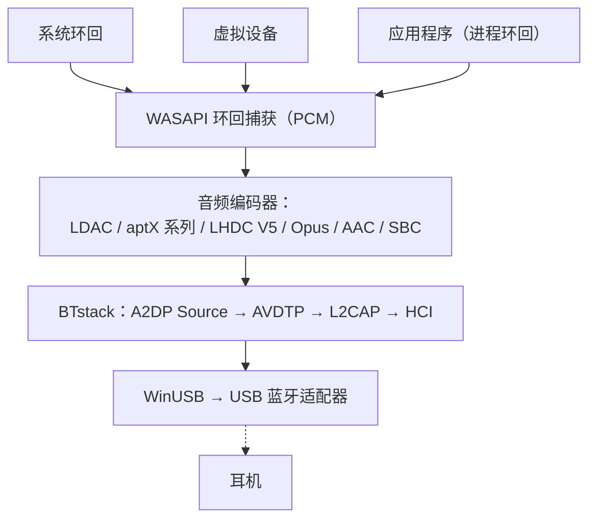

# BlueCaster

适用于 Windows 的高级蓝牙音频发射器，全面支持各种编解码器。
{: .fs-6 .fw-300 }

BlueCaster 能把你的蓝牙适配器变成 Hi-Fi 音频发射器，通过 **LDAC@96 kHz**、**LHDC V5@192 kHz** 和 **aptX Adaptive** 等 Hi-Fi 编解码器向你的头戴式耳机和入耳式耳机串流音频。Windows 本身不支持这些编解码器。BlueCaster 还支持 aptX HD、aptX、aptX Low Latency、Opus、AAC、SBC XQ、SBC 和 FastStream。

- **直接使用你现有的蓝牙。** 许多笔记本电脑内置的 Intel、Realtek 或 MediaTek 蓝牙都能用，便宜的 USB 适配器也可以。BlueCaster 接管适配器后，一键即可交还给 Windows。
- **只在需要时工作的耳机麦克风。** 麦克风只在应用录音时打开，其余时间音乐保持完整音质。内置噪声抑制和增益调节。
- **无需额外工具。** 在应用内即可完成适配器设置（[工作原理](architecture)）。

[开始使用](setup){: .btn .btn-primary .fs-5 .mb-4 .mb-md-0 .mr-2 }
[GitHub](https://github.com/SeiyaFunaokaJP/BlueCaster){: .btn .fs-5 .mb-4 .mb-md-0 }

---

## 支持的编解码器

| 编解码器 | 比特率 | 采样率 | 位深度 | 延迟 |
|:------|:--------|:------------|:----------|:--------|
| LHDC V5 | 400/500/900/1000 kbps，ABR 160--400 kbps | 44.1/48/96/192 kHz | 16/24 bit | -- |
| LDAC | 330/660/990 kbps | 44.1--96 kHz | 16/24/32 bit | 约 200 ms |
| aptX Adaptive | 265/427 kbps（96 kHz：646） | 48/96 kHz | 24 bit | -- |
| Opus | 256 kbps | 48 kHz | 16 bit | -- |
| aptX HD | 576 kbps | 44.1/48 kHz | 24 bit | 约 150 ms |
| aptX | 352/384 kbps | 44.1/48 kHz | 16 bit | -- |
| aptX Low Latency | 352 kbps | 44.1/48 kHz | 16 bit | 约 32 ms |
| AAC | 最高 256 kbps | 44.1/48 kHz | 16 bit | 约 150 ms |
| SBC XQ | 约 385/505/552 kbps | 44.1/48 kHz | 16 bit | 约 150 ms |
| SBC | 最高约 345 kbps | 44.1/48 kHz | 16 bit | 约 150 ms |
| FastStream | 198/216 kbps | 44.1/48 kHz | 16 bit | -- |
| Opus 05 | 256 kbps | 48 kHz | 16 bit | -- |
| LC3（LE Audio） 🧪 | 每声道 32--124 kbps | 16/24/32/48 kHz | 16 bit | 约 140 ms |
| LC3 LL（LE Audio GMAP） 🧪 | 每声道 64--96 kbps | 32/48 kHz | 16 bit | 约 30 ms |

### 各平台的编解码器支持情况（向耳机发送）

| 编解码器 | Windows 10 内置 | Windows 11 内置 | Ubuntu 内置（PipeWire） | **BlueCaster**（Windows 10 / 11） |
|:------|:-------------------:|:-------------------:|:--------------------------:|:----------------------------:|
| LHDC V5 | ❌ | ❌ | ❌ | ✅ |
| LDAC | ❌ | ❌ | ✅ | ✅ |
| aptX Adaptive | ❌ | ❌ | ❌ | ✅ |
| Opus（Android 的 A2DP Opus） | ❌ | ❌ | ✅ PipeWire 1.2+（`opus_g`）；Ubuntu 24.04（PipeWire 1.0.5）中没有 | ✅ |
| aptX HD | ❌ | ❌ | ✅ | ✅ |
| aptX | ✅ | ✅ | ✅ | ✅ |
| aptX Low Latency | ❌ | ❌ | ✅ | ✅ |
| AAC | ❌ | ✅ | ❌ Ubuntu 软件包中未包含 | ✅ |
| SBC XQ | ❌ | ❌ | ✅ | ✅（SBC 允许双声道且 bitpool ≥ 29 的接收端） |
| SBC | ✅ | ✅ | ✅ | ✅ |
| FastStream | ❌ | ❌ | ✅ | ✅（仅音乐，需明确选择） |
| Opus 05（PipeWire 自有的 Opus） | ❌ | ❌ | ✅ PipeWire 0.3.57+（`opus_05`，仅限 PipeWire 设备） | ✅（需明确选择，仅限开发者模式） |
| LC3（LE Audio，BAP 单播） | ❌ | ✅ 需要 PC 的蓝牙硬件和驱动程序支持 LE Audio | ✅ PipeWire BAP `lc3`（BlueZ LE Audio） | 🧪 实验性，仅限开发者模式（设备的 LE Audio 条目；游戏耳机使用 GMAP 低延迟；需要支持 ISO 的蓝牙 5.2 适配器，[使用方法](usage#le-audio)） |

✅ 支持 · 🧪 实验性 · ❌ 不支持。所有列均指发送端（PC → 耳机）。“内置”指不使用 BlueCaster 时操作系统自带的蓝牙音频；Ubuntu 一列列出的是 Ubuntu 26.04 中 PipeWire 支持的编解码器（`libspa-0.2-bluetooth`）。

{: .warning }
**aptX HD 和 aptX Low Latency** 参照 Android / PipeWire 的实现，并通过了编码/解码往返测试，但尚未在真实耳机上验证。表中的延迟为典型值，并非使用 BlueCaster 实测。

{: .warning }
**关于 LHDC V5。** BlueCaster 使用 Google 在 Android 17 中加入的 LHDC V5 编码器（AOSP，Apache-2.0）的 C 语言移植版。移植版的输出与 AOSP 的 Rust 编码器逐位一致，A2DP 信令则参照 Android 的 `a2dp_vendor_lhdcv5`。已有用户在 v1.1.1-beta.1 上用真实的 LHDC V5 耳机确认了 1000 kbps / 192 kHz（[#50](https://github.com/SeiyaFunaokaJP/BlueCaster/issues/50)）；v2 使用相同的编码器。只支持有损的 LHDC V5：LHDC V2/V3（较旧的耳机）和无损的“LHDC-RAW”模式没有开源编码器。在“自动”模式下，LHDC V5 排在第一位，优先于 LDAC。

{: .warning }
**Opus** 是 Android 的 A2DP Opus 厂商编解码器（Android 13+，Vendor ID 0x000000E0 Google）：48 kHz、20 ms 帧，与 Android 的请求一样采用 256 kbps 立体声（标准 192 kbps，移动 128 kbps），由 libopus 1.6.1 编码。Opus 已通过与虚拟接收端的端到端测试，但尚未在真实的 Opus 耳机上验证。在“自动”模式下，Opus 排在 aptX Adaptive 之后、aptX HD 之前。

{: .warning }
**Opus 05** 是 PipeWire 自有的 A2DP Opus 厂商编解码器（Vendor ID 0x000005F1，编解码器 0x1005；PipeWire 的 `opus_05`），只有 PipeWire 实现了这种编解码器，因此接收端必须是运行 PipeWire 并作为 A2DP 接收端的 PC。BlueCaster 只发送立体声音乐（不支持 5.1 / 7.1，也没有回传通道）：48 kHz、10 ms 帧（接收端只支持 20 ms 时用 20 ms），编码器和比特率与 Opus 相同，但不超过接收端的上限。“自动”从不选择它；请在**编解码器**页面或用 `-c opus05` 选择。它已通过与虚拟接收端（模拟 PipeWire 的能力）的端到端测试，但尚未在真实的 PipeWire 接收端上试过。PipeWire 作为 A2DP 接收端时，自 0.3.57 起可解码 Opus 05，自 1.2.0 起可解码 Android 的 Opus（`opus_g`）。Ubuntu 24.04 LTS 自带 PipeWire 1.0.5（仅 Opus 05），Ubuntu 25.10（1.4.7）和 26.04 LTS（1.6.2）则两者都支持。这两种编解码器都尚未用 BlueCaster 实际测试。

{: .warning }
**SBC XQ** 已用 Sony WH-1000XM4 验证（双声道，48 kHz 下 bitpool 43，552 kbps）。如果接收端拒绝该配置，BlueCaster 会改用普通 SBC 重新连接。**FastStream** 已通过与虚拟接收端的端到端测试，但尚未用真实的 FastStream 耳机试过。FastStream 只传输音乐，“自动”从不选择它。

{: .note }
**只需要经典 aptX？** Windows 10 的内置蓝牙堆栈已经支持经典 aptX（不含 aptX HD、aptX LL 和 aptX Adaptive），这种情况不需要 BlueCaster。BlueCaster 主要用于 LHDC V5、LDAC、aptX Adaptive、aptX HD 和 aptX Low Latency。

{: .note }
**关于 aptX Adaptive。** BlueCaster 使用 [AKS-Logic/aptx-adaptive-linux](https://github.com/AKS-Logic/aptx-adaptive-linux) 的纯 Rust 编码器（MIT 许可）进行编码。该项目的作者根据 Qualcomm 已出货的二进制文件和空中抓包，重建了编码器所用的表。规格为 48 kHz 立体声（请求 44.1 kHz 时以 48 kHz 捕获）、24-bit：高 427 kbps 或低延迟 265 kbps（R2 接收端为 270），“高”模式支持 ABR。如果你在该编解码器的设置中选择 96 kHz，且耳机是列出 96 kHz 的 R2 接收端，就会使用 96 kHz（高，646 kbps）；低延迟模式从不使用 96 kHz，“自动”以 48 kHz 串流。在“自动”模式下，aptX Adaptive 排在 LHDC V5 和 LDAC 之后；你也可以在**编解码器**页面或用 `-c aptxad` 选择它。有用户在 2.0.2-beta.6 上用 EarFun Air Pro 4+ 确认 48 kHz 可用（与经典 aptX 一样稳定），之后又在真实耳机上确认了 96 kHz（[#86](https://github.com/SeiyaFunaokaJP/BlueCaster/issues/86)）。据上游项目报告，它在 Linux 上可用于 Bose QuietComfort Ultra（第 1 代）和 B&W Px7 S2e。请参阅 [aptX 系列与 aptX Adaptive](usage#aptx-compatibility)。

## 平台支持 {#platform-support}

| 组件 | Windows 10 (x64 / ARM64) | Windows 11 (x64 / ARM64) | Linux (Ubuntu) |
|:----------|:----------------:|:----------------:|:--------------:|
| **BlueCaster**（窗口、托盘、CLI） | ✅（尚未在实机上试用） | ✅ | ❌ |
| [从源代码构建](building)（Rust、Visual Studio 2022+） | ✅ | ✅ | ❌ |
| `bluecaster_decode`（流检查工具） | ✅ | ✅ | ❌ |
| 端到端测试 `tools/emu/run_test.py` | ✅ | ✅ | ❌ |
| 虚拟适配器 `tools/emu/emu_vhci.py` | ❌ | ❌ | ✅ |
| [测量用接收器](usage#receiver) `tools/linux_sink` | ❌ | ❌ | ✅ |

BlueCaster 本身仅在 Windows 上运行（Windows 10 或 Windows 11），提供 x64 和 ARM64 版本。Linux 工具需要 Python 3.11 或更高版本（已在 Ubuntu 26.04 上验证）；`setup.sh` 面向 Ubuntu / Debian，其他发行版需要手动安装所需软件包。

## 已验证的硬件 {#verified-hardware}

已在 TP-Link UB500、通用 RTL8761B、笔记本电脑内置的 RTL8852BE、ASUS BT400 和 CSR8510 适配器上，用 Sony WH-1000XM4 和 WH-1000XM6、EarFun Air Pro 4+、Grado GW100x 等耳机测试过。完整列表（含编解码器、版本和每条记录所依据的报告）请参阅 **[已验证的硬件](hardware)**。

## 断音与连接问题

**[断音与连接问题](wireless)** 介绍了以往断音和连接问题报告的最终原因、报告之前应做的检查，以及如何解读链路质量。

## 配合使用的工具

**[配合使用的工具](works-with)** 列出了用户报告可与 BlueCaster 配合使用的第三方应用，例如耳机控制应用。这些应用并非 BlueCaster 制作，BlueCaster 也不为其提供支持。

## 音频捕获模式

BlueCaster 通过 WASAPI 捕获音频，提供三种模式：

| 模式 | 说明 | 用途 |
|:-----|:------------|:---------|
| **默认设备** | 捕获默认播放设备输出的全部系统音频 | 设置简单，所有声音都会串流 |
| **虚拟设备** | 从用户选择的虚拟音频设备（如 VB-CABLE、VoiceMeeter）捕获 | 把特定应用的声音送到蓝牙耳机，其他声音仍从扬声器播放 |
| **应用程序** | 只捕获某一个应用播放的声音（经过该应用自身处理后）（Windows 11 / Windows 10 2004+） | 发送单个应用的声音，或系统级音效应用（均衡器、音效增强）的输出 |

在**虚拟设备**模式下，BlueCaster 可以把所选虚拟设备设为 Windows 默认播放设备（**连接期间设为 Windows 默认输出设备**），然后捕获它的环回输出。播放到该虚拟设备的任何应用都会通过蓝牙串流。停止串流时，会恢复之前的默认设备。

**默认设备**源不会把声音从默认播放设备上“拿走”：声音会同时在该设备和蓝牙耳机上播放。如果无法打开所选的虚拟设备，BlueCaster 会改为发送系统音频，并提示你。请参阅[捕获模式](usage#capture-modes)。

## 工作原理

BlueCaster 完全绕过 Windows 的蓝牙堆栈。它通过 WinUSB 直接与 USB 蓝牙适配器通信，并借助 [BTstack](https://github.com/bluekitchen/btstack) 在用户模式下实现完整的蓝牙协议栈。音频由一个小型后台程序（`bluecaster-core.exe`，带托盘图标）负责串流；窗口只显示它的状态，因此关闭窗口不会中断音频（请参阅[架构](architecture)）。

## 功能

- **多编解码器**：LHDC V5、LDAC、aptX Adaptive、aptX、AAC、aptX HD、aptX Low Latency、Opus、Opus 05、FastStream、SBC XQ 和 SBC，自动协商
- **LE Audio（实验性，仅限开发者模式）**：通过 LC3 向 LE Audio 耳机传输（BAP 单播、一对耳机的左右两只、耳机音量、媒体按键、GMAP 低延迟）。需要支持蓝牙 5.2 等时通道的适配器。LE Audio 在真实适配器上（包括 MediaTek MT7925）尚不能稳定工作（请参阅[使用方法](usage#le-audio)）
- **三种捕获模式**：系统环回、虚拟音频设备路由，或单个应用的输出
- **窗口、托盘和 CLI**：用于设置和诊断的窗口、用于日常连接的托盘浮出窗口和菜单，以及命令行（请参阅[使用方法](usage)）
- **在应用内分配 WinUSB**：为适配器分配 WinUSB 驱动程序，也能恢复原来的驱动程序，无需 Zadig（请参阅[安装与设置](setup#winusb)）；Windows 曾通过该适配器配对的耳机无需重新配对即可连接
- **首次运行设置**：适配器、驱动程序和固件、耳机、首次连接、常规设置
- **ABR**：针对不稳定连接的自适应比特率（LDAC、LHDC V5 和 aptX Adaptive；SBC 和 SBC XQ 使用自适应 bitpool）
- **自动重新连接**：连接中断后自动重新连接（尝试 3 次；需要重启适配器时为 10 次），PC 从睡眠中唤醒后也会重新连接；可在**音频设备**页面上关闭**自动重新连接**
- **链路质量与 AFH**：显示发送内容、RSSI 和正在使用的信道；告知适配器应避开哪些 Wi-Fi 信道（请参阅[使用方法](usage#link-quality)）
- **耳机控制（AVRCP）**：音量滑块与耳机及 Windows 音量同步；耳机的播放/暂停、下一曲和上一曲按键可控制 PC 上的播放（请参阅[使用方法](usage#headphone-buttons)）
- **按设备设置**：每个音频设备都有自己的编解码器（及其设置）和输出源，在主页上并排显示，也可以从托盘连接
- **更新**：安装版会在音频设备断开连接后自动更新（请参阅[使用方法](usage#updates)）
- **本地化**：英语、日语、简体中文、繁体中文、韩语、德语、法语、西班牙语、乌克兰语、俄语
- **Realtek 固件**：引导你为 Realtek 适配器下载固件
- **诊断**：连接流程、日志、HCI 捕获、用于错误报告的诊断信息、与 Linux PC 进行的对端接收器测试（请参阅[使用方法](usage#receiver)）
