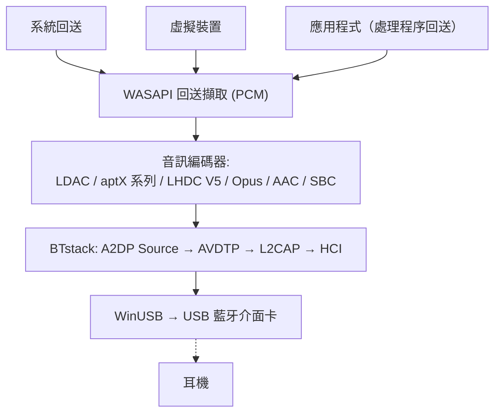

# BlueCaster

適用於 Windows 的進階藍牙音訊發射器，全面支援各種編解碼器。
{: .fs-6 .fw-300 }

BlueCaster 能把您的藍牙介面卡變成 Hi-Fi 音訊發射器，透過 **LDAC@96 kHz**、**LHDC V5@192 kHz** 與 **aptX Adaptive** 等 Hi-Fi 編解碼器將音訊串流到您的耳機。Windows 本身不支援這些編解碼器。BlueCaster 也支援 aptX HD、aptX、aptX Low Latency、Opus、AAC、SBC XQ、SBC 與 FastStream。

- **直接使用您現有的藍牙。** 許多筆電內建的 Intel、Realtek 或 MediaTek 藍牙都能用，便宜的 USB 介面卡也可以。BlueCaster 接管介面卡後，按一下就能交還給 Windows。
- **只在需要時運作的耳機麥克風。** 麥克風只在應用程式錄音時開啟，其餘時間音樂維持完整音質。內建雜訊抑制與增益調整。
- **不需要額外的工具。** 在應用程式內就能完成介面卡設定（[運作方式](architecture)）。

[開始使用](setup){: .btn .btn-primary .fs-5 .mb-4 .mb-md-0 .mr-2 }
[GitHub](https://github.com/SeiyaFunaokaJP/BlueCaster){: .btn .fs-5 .mb-4 .mb-md-0 }

---

## 支援的編解碼器

| 編解碼器 | 位元率 | 取樣率 | 位元深度 | 延遲 |
|:------|:--------|:------------|:----------|:--------|
| LHDC V5 | 400/500/900/1000 kbps，ABR 160--400 kbps | 44.1/48/96/192 kHz | 16/24 bit | -- |
| LDAC | 330/660/990 kbps | 44.1--96 kHz | 16/24/32 bit | 約 200 ms |
| aptX Adaptive | 265/427 kbps（96 kHz：646） | 48/96 kHz | 24 bit | -- |
| Opus | 256 kbps | 48 kHz | 16 bit | -- |
| aptX HD | 576 kbps | 44.1/48 kHz | 24 bit | 約 150 ms |
| aptX | 352/384 kbps | 44.1/48 kHz | 16 bit | -- |
| aptX Low Latency | 352 kbps | 44.1/48 kHz | 16 bit | 約 32 ms |
| AAC | 最高 256 kbps | 44.1/48 kHz | 16 bit | 約 150 ms |
| SBC XQ | 約 385/505/552 kbps | 44.1/48 kHz | 16 bit | 約 150 ms |
| SBC | 最高約 345 kbps | 44.1/48 kHz | 16 bit | 約 150 ms |
| FastStream | 198/216 kbps | 44.1/48 kHz | 16 bit | -- |
| Opus 05 | 256 kbps | 48 kHz | 16 bit | -- |
| LC3（LE Audio） 🧪 | 每聲道 32--124 kbps | 16/24/32/48 kHz | 16 bit | 約 140 ms |
| LC3 LL（LE Audio GMAP） 🧪 | 每聲道 64--96 kbps | 32/48 kHz | 16 bit | 約 30 ms |

### 各平台的編解碼器支援（傳送到耳機）

| 編解碼器 | Windows 10 內建 | Windows 11 內建 | Ubuntu 內建 (PipeWire) | **BlueCaster** (Windows 10 / 11) |
|:------|:-------------------:|:-------------------:|:--------------------------:|:----------------------------:|
| LHDC V5 | ❌ | ❌ | ❌ | ✅ |
| LDAC | ❌ | ❌ | ✅ | ✅ |
| aptX Adaptive | ❌ | ❌ | ❌ | ✅ |
| Opus（Android 的 A2DP Opus） | ❌ | ❌ | ✅ PipeWire 1.2+（`opus_g`）；Ubuntu 24.04（PipeWire 1.0.5）中沒有 | ✅ |
| aptX HD | ❌ | ❌ | ✅ | ✅ |
| aptX | ✅ | ✅ | ✅ | ✅ |
| aptX Low Latency | ❌ | ❌ | ✅ | ✅ |
| AAC | ❌ | ✅ | ❌ 不在 Ubuntu 的套件中 | ✅ |
| SBC XQ | ❌ | ❌ | ✅ | ✅（SBC 允許雙聲道且 bitpool ≥ 29 的接收端） |
| SBC | ✅ | ✅ | ✅ | ✅ |
| FastStream | ❌ | ❌ | ✅ | ✅（僅限音樂，需明確選擇） |
| Opus 05（PipeWire 自有的 Opus） | ❌ | ❌ | ✅ PipeWire 0.3.57+（`opus_05`，僅限 PipeWire 裝置） | ✅（需明確選擇，僅限開發人員模式） |
| LC3（LE Audio，BAP 單播） | ❌ | ✅ 僅限藍牙硬體與驅動程式支援 LE Audio 的電腦 | ✅ PipeWire BAP `lc3`（BlueZ LE Audio） | 🧪 實驗性，僅限開發人員模式（使用裝置的 LE Audio 項目；電競耳機使用 GMAP 低延遲；需要支援 ISO 的 Bluetooth 5.2 介面卡，[使用方式](usage#le-audio)） |

✅ 支援 · 🧪 實驗性 · ❌ 不支援。所有欄位都是傳送端（電腦 → 耳機）。「內建」指不使用 BlueCaster 時，作業系統本身的藍牙音訊；Ubuntu 欄位為 Ubuntu 26.04 PipeWire 的編解碼器組合（`libspa-0.2-bluetooth`）。

{: .warning }
**aptX HD 與 aptX Low Latency** 依照 Android / PipeWire 的實作，並通過編碼/解碼往返測試，但尚未在實際耳機上驗證。表中的延遲為一般數值，並非用 BlueCaster 實測。

{: .warning }
**關於 LHDC V5。** BlueCaster 使用 Google 加入 Android 17 的 LHDC V5 編碼器（AOSP，Apache-2.0）的 C 語言移植版。移植版的輸出與 AOSP 的 Rust 編碼器位元完全一致，A2DP 信令則依照 Android 的 `a2dp_vendor_lhdcv5`。已有使用者在 v1.1.1-beta.1 上以實際的 LHDC V5 耳機確認可在 1000 kbps / 192 kHz 下運作（[#50](https://github.com/SeiyaFunaokaJP/BlueCaster/issues/50)）；v2 使用相同的編碼器。僅支援有損的 LHDC V5：LHDC V2/V3（較舊的耳機）與無損的「LHDC-RAW」模式沒有開放原始碼的編碼器。在「自動」模式下，LHDC V5 排在第一位，高於 LDAC。

{: .warning }
**Opus** 是 Android 的 A2DP Opus 廠商編解碼器（Android 13 以上，廠商 ID 0x000000E0 Google）：48 kHz、20 ms 訊框，依照 Android 的要求以 256 kbps 立體聲傳送（標準 192、行動 128 kbps），使用 libopus 1.6.1 編碼。它通過了針對虛擬接收端的端對端測試，但尚未在實際的 Opus 耳機上驗證。在「自動」模式下，它排在 aptX Adaptive 之後、aptX HD 之前。

{: .warning }
**Opus 05** 是 PipeWire 自有的 A2DP Opus 廠商編解碼器（廠商 ID 0x000005F1，編解碼器 0x1005；PipeWire 的 `opus_05`）。只有 PipeWire 實作了它，因此接收端必須是以 PipeWire 作為 A2DP 接收端的電腦。BlueCaster 只傳送立體聲音樂（不支援 5.1 / 7.1，也沒有回傳通道）：48 kHz、10 ms 訊框（接收端只支援 20 ms 時使用 20 ms），編碼器與位元率和 Opus 相同，並以接收端的上限為限。「自動」不會選擇它；請在 **編解碼器** 畫面或用 `-c opus05` 選擇。它已通過針對虛擬接收端（提供 PipeWire 的能力）的端對端測試，但尚未用實際的 PipeWire 接收端試過。作為 A2DP 接收端時，PipeWire 自 0.3.57 起可解碼 Opus 05，自 1.2.0 起可解碼 Android 的 Opus（`opus_g`）。Ubuntu 24.04 LTS 內附 PipeWire 1.0.5（僅 Opus 05）；Ubuntu 25.10（1.4.7）與 26.04 LTS（1.6.2）兩者都有。這兩種編解碼器都尚未用 BlueCaster 測試。

{: .warning }
**SBC XQ** 已用 Sony WH-1000XM4 驗證（雙聲道，48 kHz 下 bitpool 43，552 kbps）。如果接收端拒絕這個設定，BlueCaster 會改用一般 SBC 重新連線。**FastStream** 已通過針對虛擬接收端的端對端測試，但尚未用實際的 FastStream 耳機試過。它只傳送音樂，「自動」也不會選擇它。

{: .note }
**只需要傳統 aptX？** Windows 10 的內建藍牙堆疊已支援傳統 aptX（不含 aptX HD、aptX LL 或 aptX Adaptive），因此不需要 BlueCaster。BlueCaster 主要用於 LHDC V5、LDAC、aptX Adaptive、aptX HD 與 aptX Low Latency。

{: .note }
**關於 aptX Adaptive。** BlueCaster 使用 [AKS-Logic/aptx-adaptive-linux](https://github.com/AKS-Logic/aptx-adaptive-linux) 以純 Rust 撰寫、採用 MIT 授權的編碼器。編碼器的表格是作者根據 Qualcomm 出貨的二進位檔與空中擷取資料重建的。規格為 48 kHz 立體聲（要求 44.1 kHz 時以 48 kHz 擷取）、24 位元：高品質 427 kbps 或低延遲 265 kbps（R2 接收端：270），高品質時使用 ABR。只有在編解碼器設定中選擇 96 kHz，且耳機是列出 96 kHz 的 R2 接收端時，才會使用 96 kHz（高品質，646 kbps）；低延遲一律不使用 96 kHz，「自動」則以 48 kHz 串流。「自動」會把 aptX Adaptive 排在 LHDC V5 與 LDAC 之後；您也可以在 **編解碼器** 畫面或用 `-c aptxad` 選擇。有使用者在 2.0.2-beta.6 上以 EarFun Air Pro 4+ 確認 48 kHz 可正常運作（與傳統 aptX 一樣穩定），之後也在實際耳機上確認了 96 kHz（[#86](https://github.com/SeiyaFunaokaJP/BlueCaster/issues/86)）。上游回報在 Linux 上搭配 Bose QuietComfort Ultra（第 1 代）與 B&W Px7 S2e 可正常運作。請參閱 [aptX 系列與 aptX Adaptive](usage#aptx-compatibility)。

## 平台支援 {#platform-support}

| 元件 | Windows 10 (x64 / ARM64) | Windows 11 (x64 / ARM64) | Linux (Ubuntu) |
|:----------|:----------------:|:----------------:|:--------------:|
| **BlueCaster**（視窗、系統匣、CLI） | ✅（尚未在實機上試過） | ✅ | ❌ |
| [從原始碼建置](building)（Rust、Visual Studio 2022 以上） | ✅ | ✅ | ❌ |
| `bluecaster_decode`（串流檢查工具） | ✅ | ✅ | ❌ |
| 端對端測試 `tools/emu/run_test.py` | ✅ | ✅ | ❌ |
| 虛擬介面卡 `tools/emu/emu_vhci.py` | ❌ | ❌ | ✅ |
| [測量用接收器](usage#receiver) `tools/linux_sink` | ❌ | ❌ | ✅ |

BlueCaster 本身只能在 Windows（Windows 10 或 Windows 11）上執行，提供 x64 與 ARM64 版本。Linux 工具需要 Python 3.11 以上（已在 Ubuntu 26.04 驗證）；`setup.sh` 適用於 Ubuntu / Debian，其他發行版需手動安裝套件。

## 已驗證的硬體 {#verified-hardware}

已搭配 Sony WH-1000XM4 與 WH-1000XM6、EarFun Air Pro 4+、Grado GW100x 等耳機測試，使用的介面卡包括 TP-Link UB500、通用 RTL8761B、筆電內建的 RTL8852BE、ASUS BT400 與 CSR8510。**[已驗證的硬體](hardware)** 有完整清單，並列出編解碼器、版本與每一項的相關回報。

## 斷音與連線問題

**[斷音與連線問題](wireless)** 說明過去斷音與連線問題的回報最後查出的原因、回報前應先做的檢查，以及如何解讀連線品質。

## 搭配使用的工具

**[搭配使用的工具](works-with)** 列出使用者回報可與 BlueCaster 搭配使用的第三方應用程式，例如耳機控制 App。這些工具並非 BlueCaster 製作或支援。

## 音訊擷取模式

BlueCaster 透過 WASAPI 擷取音訊，提供三種模式：

| 模式 | 說明 | 使用情境 |
|:-----|:------------|:---------|
| **預設裝置** | 擷取預設播放裝置的所有系統音訊輸出 | 設定簡單，所有聲音都會串流 |
| **虛擬裝置** | 從使用者選取的虛擬音訊裝置（例如 VB-CABLE、VoiceMeeter）擷取 | 將特定應用程式導向藍牙，其他音訊仍由喇叭播放 |
| **應用程式** | 只擷取單一應用程式播放的內容，包含該應用程式自身的處理（Windows 11 / Windows 10 2004 以上） | 傳送單一應用程式，或全系統音效應用程式（等化器、音效增強器）的輸出 |

在 **虛擬裝置** 模式下，BlueCaster 可以把選取的虛擬裝置設為 Windows 預設播放裝置（**連線時設為 Windows 預設輸出**），再擷取它的回送輸出。任何輸出到這個虛擬裝置的應用程式，都會透過藍牙串流。停止串流時，會還原原本的預設裝置。

**預設裝置** 來源不會把音訊從預設播放裝置上移走：聲音會同時從該裝置與藍牙播放。如果無法開啟選取的虛擬裝置，BlueCaster 會改為傳送系統音訊，並通知您。請參閱 [擷取模式](usage#capture-modes)。

## 運作方式

BlueCaster 完全不經過 Windows 藍牙堆疊。它透過 WinUSB 直接與 USB 藍牙介面卡通訊，並使用 [BTstack](https://github.com/bluekitchen/btstack) 在使用者模式下實作完整的藍牙通訊協定堆疊。音訊由一個在背景執行的小程式（`bluecaster-core.exe`，附系統匣圖示）負責串流；視窗只顯示它的狀態，因此關閉視窗不會停止音訊（請參閱 [架構](architecture)）。

## 功能

- **多種編解碼器**：LHDC V5、LDAC、aptX Adaptive、aptX、AAC、aptX HD、aptX Low Latency、Opus、Opus 05、FastStream、SBC XQ 及 SBC，自動協商
- **LE Audio（實驗性，僅限開發人員模式）**：以 LC3 傳送到 LE Audio 耳機與耳塞式耳機（BAP 單播、同一對耳塞式耳機的左右兩耳、耳機音量、媒體按鍵、GMAP 低延遲）。需要支援 Bluetooth 5.2 等時通道的介面卡。LE Audio 在實體介面卡上（包括 MediaTek MT7925）尚無法穩定運作（[使用方式](usage#le-audio)）
- **三種擷取模式**：系統回送、虛擬音訊裝置路由，或單一應用程式的輸出
- **視窗、系統匣與 CLI**：用於設定與診斷的視窗、日常連線用的系統匣視窗與選單，以及命令列（請參閱 [使用方式](usage)）
- **在應用程式中設定 WinUSB**：為介面卡指派 WinUSB 驅動程式，也能還原原本的驅動程式，不需要 Zadig（請參閱 [安裝設定](setup#winusb)）；Windows 先前透過這張介面卡配對的耳機，不必重新配對即可連線
- **首次執行設定**：介面卡、驅動程式與韌體、耳機、第一次連線、一般設定
- **ABR**：針對不穩定連線的自適應位元率（LDAC、LHDC V5 與 aptX Adaptive；SBC 與 SBC XQ 使用自適應 bitpool）
- **自動重新連線**：連結中斷後重新連線（3 次；介面卡需要重新啟動時為 10 次），電腦從睡眠中恢復後也會重新連線；可在 **音訊裝置** 畫面中關閉 **自動重新連線**
- **連線品質與 AFH**：顯示傳送的內容、RSSI 與使用中的通道，並告知介面卡應避開哪些 Wi-Fi 通道（請參閱 [使用方式](usage#link-quality)）
- **耳機控制 (AVRCP)**：音量滑桿與耳機及 Windows 音量同步；耳機的播放/暫停、下一首與上一首按鈕可控制電腦上的播放（請參閱 [使用方式](usage#headphone-buttons)）
- **依裝置設定**：每個音訊裝置都有各自的編解碼器（含設定）與輸出來源，在首頁並排顯示，也可從系統匣連線
- **更新**：已安裝的版本會在音訊裝置中斷連線後自動更新（請參閱 [使用方式](usage#updates)）
- **多語系**：英文、日文、簡體中文、繁體中文、韓文、德文、法文、西班牙文、烏克蘭文、俄文
- **Realtek 韌體**：引導您下載 Realtek 介面卡的韌體
- **診斷**：連線流程、記錄、HCI 擷取、供錯誤回報使用的診斷資訊，以及與 Linux 電腦進行的對端接收器測試（請參閱 [使用方式](usage#receiver)）
